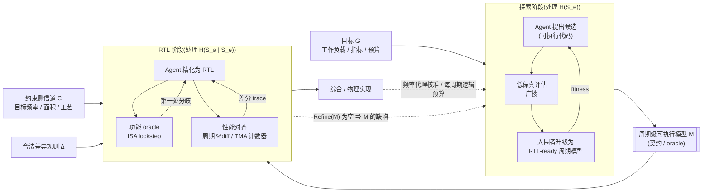

# 01 · 写作规划:架构探索 × RTL agentic 生成,以周期级可执行模型为桥

> 本文件供"成文模型"直接使用,成文时无需再做调研。
> 依据:`00-context-brief.md`、`docs/case-studies/*.rst`、`docs/信息论.pdf`(已用 pdftotext 逐条核对)、CHIA 论文 arXiv 2606.27350 HTML 全文(**已成功获取并阅读**)、`02-research-notes.md`(所有外部文献的核实记录与原文摘录)。
> 约定:**[假说]** 表示笔者提出、尚无直接实证的判断;**[文献]** 表示有已核实来源;**[CHIA-docs]** 表示仓库 docs / brief 中的事实;**[CHIA-paper]** 表示仅在论文正文出现、docs 中没有的事实(已核实,可用但需注明来源)。

---

## 1. 论点精炼

### 1.1 一句话主论点

> **在 agent 时代,"自动架构探索"与"RTL 生成"应被当作两个问题来解,并以一个"周期级可执行模型"(下称周期模型 M)作为二者的契约:探索阶段负责把先验覆盖不到的本质复杂性写成可执行代码 M;RTL 阶段负责在以 M 为 oracle 的机器可判定反馈下,把 M 精化为 RTL。**

措辞建议:主论点里不要用"周期精确模型就是一切";强调"契约""精化""oracle"三个词。

### 1.2 可被反驳的子论点

| # | 子论点 | 可被反驳的方式 | 强度评估 |
|---|---|---|---|
| C1 | **拆分合理**:两个阶段的目标函数、搜索空间、评估成本、验证方式不同;IPC 类目标只依赖周期行为,因此探索可以在"周期行为等价类"上进行,不必在 RTL 空间里搜 | 给出一个案例:物理实现强烈改变探索结论(频率与 IPC 不可分) | **强**,但需承认"物理耦合"并给出代理条件(§2.4 引理) |
| C2 | **探索的交付物应是周期模型**(注意:是"交付物",不是"探索全程使用的评估器") | 指出高保真模型太慢,强迫探索在周期精确模型上进行会扼杀探索广度 | **最脆弱**。必须修正为"多保真度级联:粗模型广搜,入围者升级为 RTL-ready 的周期模型"。现有探索流程(ChampSim trace 模拟器)的产出并不 RTL-ready,ArchAgent 自己也承认可实现性需要人工确认 |
| C3 | **RTL 生成应以周期模型为主要对齐手段**,而不是以自然语言规约为主 | (i) 端到端 NL→RTL 已有成功案例(Design Conductor);(ii) LLM 从 NL 写参考模型同样很差(ChipBench);(iii) 逐周期一致会过度约束 RTL | **强**(ISA 层"RTL 追可执行规约"早已是工业标准:Spike/NEMU/Arm ASL)。脆弱点在"逐周期严格一致"——需改为"功能精确 + 性能在容差/规则内一致" |
| C4 | **代码优于自然语言,关键不只是歧义小,而是"可执行 ⇒ 歧义可被检测、反馈可由机器生成"** | 指出代码也会精确地错;或指出 NL 规约 + LLM 澄清提问也能检测歧义 | **最有信息增量的洞察**,建议作为文章核心。其中"α_NL 随精度要求上升而上升"是 **[假说]**,只有旁证 |

**最强**:C4(最有新意且推导干净)、C3(有工业先例)。
**最脆弱**:C2(保真度—速度张力 + 现有探索产出不 RTL-ready),以及 C3 中"逐周期严格一致"的强版本。成文时应主动收窄这两点,收窄本身就是展示深度的机会。

---

## 2. 形式化推导(信息论记账模型)

### 2.0 记号与诚实声明(成文时必须写一段)

- 沿用 `docs/信息论.pdf` 的记号:$S$、$H(S)$、$K=K_{\text{pretrain}}\cup K_{\text{RAG}}\cup K_{\text{context}}$、$I(S;K)$、$S_e/S_a$、$\alpha$、$m_t$。
- **诚实声明**:单个设计的"熵"严格说没有定义(熵属于分布,不属于个体)。本文把 $H(\cdot)$ 当作**描述长度意义上的记账单位**(“要说清楚它需要多少比特”),用来比较两条路线的相对成本与结构,而不是用来测量。成文时用一句话说明:"这是一个记账模型,不是一个测量理论;它的用处是告诉我们成本落在哪里、谁来支付。"——资深读者会认可这种克制。
- 新增记号(本文引入,成文时需定义):
  - $R$:RTL 实现。
  - $\mathcal{O}$:**观测接口**(例如:提交流 + 每条提交指令的周期戳 + 一组约定的微架构事件/计数器)。
  - $h(R)$:RTL 在 $\mathcal{O}$ 上表现出的周期级行为(对所有输入程序)。
  - $M$:周期级可执行模型;$R \models M$ 表示 $R$ 精化 $M$,即 $h(R)$ 与 $M$ 在 $\mathcal{O}$ 上一致(或满足约定的差异规则 $\Delta$)。
  - $\mathrm{Refine}(M)=\{R: R\models M\}$。
  - $G$:探索目标(工作负载、指标、预算);$C$:物理/实现约束侧信道(目标频率、面积预算、工艺);$\Delta$:合法差异规则(哪些周期级差异被允许)。

### 2.1 "本质/偶然"复杂性的可操作定义

令 $S_e := h(R)$(即 RTL 的周期行为等价类),由于 $S_e$ 是 $R$ 的确定性函数:

$$H(R)=H(R,h(R))=H(S_e)+H(R\mid S_e).$$

**洞察**:信息论.pdf 中的 $H(S)=H(S_e)+H(S_a\mid S_e)$ 在这个定义下**不是比喻而是恒等式**——把"本质复杂性"定义为"在观测接口上可区分的行为",其余($R$ 在给定 $S_e$ 下的剩余自由度)就是偶然复杂性。

**必须同时说明的反面**:本质/偶然是**相对目标函数**而言的。对功能和 IPC,$H(R\mid S_e)$ 是偶然的;对频率/面积,它不是——同一个 $M$ 的不同精化 $R$ 可以有截然不同的 $F_{\max}$。CHIA 时序优化案例的"IPC-neutral"提示词,本质上就是"固定 $M$、只在 $\mathrm{Refine}(M)$ 内优化物理质量"。这句话是连接 §2 与反驳 (c) 的枢纽。

### 2.2 为什么拆:三个可推导的好处

**(1) 搜索空间商化。** 若目标只依赖周期行为,$J(R)=\tilde J(h(R))$,则

$$\max_{R} J(R)=\max_{M}\tilde J(M),$$

探索只需在 $H(S_e)$ 比特的空间里搜,而不是 $H(S_e)+H(R\mid S_e)$ 比特。**洞察**:在 RTL 空间里做探索,会把评估预算浪费在"fitness 等价"的候选上(同一 $M$ 的不同写法)。

**(2) 评估成本分层。** 设候选数 $N$、入围数 $k\ll N$,单次评估成本 $c_M \ll c_R$,单个 RTL 的生成+调试成本 $g_R$:

$$\underbrace{N c_M + k\,(g_R + c_R)}_{\text{拆分}}\quad\text{vs}\quad \underbrace{N\,(g_R + c_R)}_{\text{在 RTL 上探索}}.$$

**洞察**:拆分的收益不只来自"模拟快",更来自"不必为每个候选写一份 RTL"。可用的已核实量级(只用这些,勿编造新数字):ArchAgent 中单次 ChampSim 1B 指令模拟可 >12 小时 **[文献 B1]**;XiangShan 在单块 FPGA 上跑完 SPEC CPU2006 需 >150 小时、软件 RTL 仿真为 KHz 量级 **[文献 E4]**;Assassyn 中与 RTL 逐周期对应的模拟器比 Verilator 快约 2.2×,而 gem5 在长负载上再快一个数量级 **[文献 D1]**。

**(3) 可验证性分解(数据处理不等式)。** 若 RTL agent 只看到 $(M,C)$(外加共享先验 $K$),则构成马尔可夫链 $G\to(M,C)\to R$,于是

$$I(G;R\mid K)\le I(G;M,C\mid K).$$

**洞察(两层)**:
- **上界**:RTL 对设计意图的对齐程度不可能超过"模型 + 约束"——所以对齐的功夫应花在 $M$ 与 $C$ 上,它们比 RTL 小、可读、可执行。
- **分解**:对齐问题被拆成两个**可分别检查**的半段:$G\leftrightarrow M$ 由探索的 fitness 与人工审阅把关;$R\models M$ 由协同仿真机械判定。直接 NL→RTL 则只有一个不可分解的大检查。

**$I(G;R\mid M,C,K)\approx 0$ 何时成立**:当且仅当上述马尔可夫性成立,即 RTL agent 不再从原始 NL 文档获取额外意图。若 RTL agent 同时读 NL 文档,该项 $>0$:可能补洞,也可能与 $M$ 冲突。建议在文中给出工程规则:**$M$ 是单一事实来源;NL 只作注释;冲突时以 $M$ 为准,冲突本身记为 $M$ 的缺陷**。

**数据处理不等式在哪里"咬人"**:凡是 $M$ 不表达的意图(PPA 目标、时钟/复位策略、DFT、功耗意图),必须进入 $C$,否则 RTL 阶段在信息上**不可能**恢复它。这是"PPA 从探索中分离"的精确边界:不是"不要 PPA",而是"PPA 走显式侧信道 $C$"。Design Conductor 2.0 的结论"唯一的办法是让人类设计者事先想清楚关键约束(PPA)" **[文献 C22]** 是这一点的实践印证。

### 2.3 为什么周期模型是好的对齐媒介

**(1) 把 α 定义得不再同义反复。** 信息论.pdf 中 α 是"自然语言相对形式化代码的歧义开销",若直接说"α_code = 1"是同义反复。建议成文时这样定义:对通道 $X$(NL 文档或代码),令 $L_X(\delta)$ 为把残余歧义压到 $\delta$ 以下所需的消息长度,

$$A_X := H(S_e\mid x,K),\qquad \alpha_X(\delta):=\frac{L_X(\delta)}{H(S_e\mid K)} .$$

- 代码 $M$:在 $\mathcal{O}$ 上 $A_M=0$(执行它就回答了该层的一切"会怎样"),其 $\alpha_M\ge 1$ 来自建模样板,**但大致是常数**。
- **[假说]** 自然语言:$\alpha_{NL}(\delta)$ 随 $\delta\to 0$ 上升——对周期级交互(冒险、背压、仲裁的组合),要求越精确,NL 越冗长且越不可靠。旁证:Design Conductor 发现规约必须写得"extremely deliberate, tight, and verifiable/measurable",少了 CPI 那一行就会出现分支/前递性能显著更差的处理器 **[文献 C21]**;LLM-FSM 中 NL 规约是结构化 YAML 的渲染,FSM 复杂度上升时精度骤降 **[文献 C13]**;HLSPilot 直接称之为"substantial semantic gap between natural language expressions and hardware design intent" **[文献 C23]**。

**(2) 歧义的可检测性(本文核心洞察,建议重点写)。** 把残余歧义拆成可检测与沉默两部分:

$$A_X = A_X^{\text{detect}} + A_X^{\text{silent}}.$$

- NL 通道没有 oracle:agent 选定一种解释并且**不报告**,几乎全部是 $A^{\text{silent}}$。错误要到很后面才以 bug 形式出现。
- 可执行 $M$ + 协同仿真:任何会改变 $\mathcal{O}$ 上行为的误解都会以**分歧**形式出现(检测概率由激励覆盖率决定);$A^{\text{silent}}$ 只剩"$\mathcal{O}$ 之外的行为"和"未覆盖的输入"。
- **洞察**:代码的优势不是"更少歧义"而是**"把沉默的歧义变成可检测的分歧"**;因而设计观测接口 $\mathcal{O}$ 与激励覆盖,就是在设计 $A^{\text{silent}}$ 的上界。
- CIRCT 的 UNCLEAR 门是同一原理在"没有可执行规约"时的替代品:枚举实质不同的合理解法,数量 $>1$ ⇒ $H(\text{fix}\mid\text{issue},K)>0$ ⇒ 拒绝行动 **[CHIA-docs]**;软件领域 ClarifyGPT 用"多个候选代码不一致"检测需求歧义 **[文献 C20]**,结构相同。

**(3) 新颖性把 NL 推入悖论区间。** 探索的产出中真正有价值的部分,按定义是先验没有覆盖的(否则就不叫发现):对新颖部分 $S_e^{\text{new}}$,$I(S_e^{\text{new}};K)\approx 0$。由定理 4.1/推论 4.2,对任意 $\alpha>1$,用 NL 传递这部分的成本 $\ge$ 直接写代码的成本。

**洞察**:**"越是有价值的探索结果,越不能用自然语言交接。"** 而探索过程恰好已经把它写成了可执行代码(候选就是模拟器里的代码),所以交接 $M$ 的边际成本很低。(严谨性提示:若"发现"是已知部件的新组合,$I(S_e;K)$ 部分为正;成文时可写成新颖比例 $\rho = H(S_e\mid K)/H(S_e)$,结论随 $\rho$ 增大而增强。)

**(4) 迭代修正:信息守恒,付费者变了。** 由信息论.pdf 命题 5.1,收敛时 $\sum_t H(m_t)=H(S\mid K)$,与一次性表达无异。把修正消息拆成人写的与 oracle 生成的:$m_t=(m_t^{h},m_t^{o})$,人的成本只有

$$E_{\text{human}}=\sum_t H(m_t^{h}).$$

有了 $M$ 作 oracle,"RTL 哪里不对"这类修正由 $m_t^{o}$(第一处分歧的指令/周期、对应的 trace 片段)承担,由算力支付;人只需支付 $M$ 不能表达的 $C$ 与 $\Delta$。
**洞察**:**信息总量守恒,但付费者从人变成了机器**;并且机器通道带宽远高于人(riscv-dv 随机程序 lockstep 共仿数百万条指令 **[CHIA-docs]**)。这把信息论.pdf 注记 5.1 中"反馈引导、隐式确认"从定性优点变成了可计量的成本转移。riscv_extensions 中"没有任何手写 expected output——golden model 本身就是检查" **[CHIA-docs]** 是最干净的实例。

### 2.4 账要算全:什么时候分治更划算(诚实边界)

$M$ 自身的描述长度并不小(CHIA 论文中对齐后的 gem5 核相对基线有 1520 行 diff **[CHIA-paper]**)。分两种情形比较 RTL 阶段的人类比特成本(两条路线对 $S_a$ 同样享受命题 3.1,故 $S_a$ 项相消;$V_{NL}$ 为直接路线中为了判定对错而必须由人写下的检查,如 testbench 期望值):

约束记账要公平:两条路线都要说出基本的 PPA 目标(如"CPI ≤ 1.5、目标 1.6GHz",大多是数字,$\alpha\approx 1$),记为公共项 $H(C_0)$,两边相消;只有**因拆分而必须额外跨越边界的约束信息**(每周期逻辑预算、物理反馈、工艺相关代理)才算分治的成本,记为 $H(C^{+})=H(C_{\text{split}})-H(C_0)\ge 0$。同理,合法差异规则 $\Delta$ 只在有 oracle 的路线中需要显式写出。

- 直接路线:$E_{\text{direct}}\approx \alpha_{NL}\,H(S_e\mid K)+V_{NL}+H(C_0)$
- **情形 A:$M$ 是探索的副产品**:$E_{\text{split}}\approx c_{\text{ready}}+H(C^{+})+H(\Delta)+H(C_0)$,其中 $c_{\text{ready}}$ 是把探索产出升级为 RTL-ready 周期模型的代价。
- **情形 B:$M$ 需要专门写**:$E_{\text{split}}\approx H(S_e\mid K)+H(C^{+})+H(\Delta)+H(C_0)$。

情形 B 下分治更划算的条件($H(C_0)$ 相消):

$$(\alpha_{NL}-1)\,H(S_e\mid K)+V_{NL}\;>\;H(C^{+})+H(\Delta).$$

**这个不等式承载的三个洞察**(成文时逐条解读,不要只摆公式):
1. **新颖性越高越该分治**:左边随 $H(S_e\mid K)$(未被先验覆盖的本质复杂性)线性增长。
2. **它也解释了端到端为什么有时能赢**:教科书级 5 级流水线 + 现成 Spike oracle ⇒ $H(S_e\mid K)$ 小、$V_{NL}$ 小 ⇒ 左边小 ⇒ 直接路线可行。这正是 Design Conductor 的区间 **[文献 C21]**。框架同时预测了两种结果,比单边论证更有说服力。
3. **分治的真实成本是"因为拆开而必须额外说出的东西"**:$H(C^{+})+H(\Delta)$。物理耦合越强(越多信息必须跨越模型边界回传)、合法的周期级不确定性越多($\Delta$ 越复杂),分治的优势越小。这就是反驳 (b)(c)(f3) 的着力点,写作时要把它当作论点的边界条件,而不是回避。

情形 A 的含义:若探索本来就要做,$M$ 几乎免费;但若探索是在低保真评估器(如 trace 驱动的 ChampSim)上做的,$c_{\text{ready}}$ 就会接近一次 gem5 对齐的代价——**这正是 C2 需要收窄的原因**。

**机器成本**:总成本 $E_{\text{total}}=E_{\text{human}}+\lambda\,C_{\text{machine}}$,$\lambda$ 是算力/token 相对人力的价格。分治路线把成本从人转到机器(cosim 占 riscv_extensions 总机时的 50%–66% **[CHIA-paper]**),所以 **[假说]** 随着 $\lambda$ 下降,分界线持续向分治一侧移动。

**物理耦合的代理引理(回应 Iron Law,建议放进正文,推导很短)。** 设 $\mathrm{Perf}(M,R)=\mathrm{IPC}(M)\cdot f(R)$,$f^*(M)=\max_{R\in\mathrm{Refine}(M)}f(R)$。若有频率代理 $\hat f$ 满足在候选集上

$$\ln\hat f(M)=\ln f^*(M)+b+e(M),\quad |e(M)|\le\varepsilon,$$

(常数偏置 $b$ 任意),则按 $\mathrm{IPC}\cdot\hat f$ 选出的 $\hat M$ 满足

$$\frac{\mathrm{IPC}(M^*)f^*(M^*)}{\mathrm{IPC}(\hat M)f^*(\hat M)}\le e^{2\varepsilon}.$$

证明三行:$\mathrm{IPC}(\hat M)f^*(\hat M)\ge \mathrm{IPC}(\hat M)\hat f(\hat M)e^{-b-\varepsilon}\ge \mathrm{IPC}(M^*)\hat f(M^*)e^{-b-\varepsilon}\ge \mathrm{IPC}(M^*)f^*(M^*)e^{-2\varepsilon}$。

**洞察**:探索阶段不需要 RTL/物理实现在环,需要的是一个**排序正确**(相对误差有界、绝对偏置无所谓)的频率/面积代理;以及在 $M$ 中显式表达"每周期做多少事"(它决定 $f^*(M)$ 的上限)。CHIA 时序案例中 Sky130 上的改进在 16nm 上只有第一项泛化 **[CHIA-paper]**,说明代理的 $\varepsilon$ 强依赖工艺——**工艺相关信息不应固化进 $M$,而应作为可替换的 $\hat f$/约束 $C$**。

### 2.5 数学自查清单(成文后请验证者复核)

- [ ] §2.1 链式法则在 $S_e=h(R)$ 为确定性函数时严格成立(因 $H(R,h(R))=H(R)$)。
- [ ] §2.2(3) 数据处理不等式的方向:$I(G;R\mid K)\le I(G;M,C\mid K)$,前提是条件于 $K$ 的马尔可夫性。
- [ ] §2.3(3) 推论 4.2 的使用:$I\to 0$ 时 $\alpha H(S\mid K)=\alpha H(S)>H(S)$(对 $\alpha>1$)。
- [ ] §2.3(4) 伸缩求和只在收敛($H(S\mid K,m_{1..T})=0$)时等于 $H(S\mid K)$;若未收敛,应写成不等式。
- [ ] §2.4 引理的三步不等式与偏置 $b$ 相消。
- [ ] §2.4 不等式中 $S_a$ 项相消的假设(两路线 agent 能力相同)、公共约束项 $H(C_0)$ 相消、只计入额外跨边界约束 $H(C^{+})$ 的记账口径,均已在正文写明。
- [ ] 全文没有把记账量当作可测量的比特数来报告具体数值。

---

## 3. 关键反驳与回应(8 条)

每条按"承认 → 收窄 → 证据"组织。成文时可选 5–6 条展开,其余压缩为一段。

### (a) "RTL 本身就是周期精确的,你说的周期模型和 RTL 的边界在哪?"
- **承认**:RTL 确实是周期精确的,而且是周期精确族中最精化的成员。
- **收窄/定义**:周期模型 M = 在约定观测接口 $\mathcal{O}$ 上**逐周期确定行为**的**最粗**可执行描述:抽象状态(队列、表项、流水线占用)、宿主语言算术、无需可综合、不含线网/位宽/时钟复位/物理结构。形式上 $M$ 是 $R$ 在 $h$ 下的商。借用 PyMTL 的 FL/CL/RTL 三层 **[文献 D2]**:本文的 M ≈ CL 层;TLM 分类中的 cycle-accurate computation model **[文献 D4]** 是同一概念的 ESL 版本。
- **修辞建议**:提出"精确是一个关系,不是一个属性"——在本文流程中,**不是模型对 RTL 精确,而是 RTL 对模型精确**。
- 术语建议:正文用"周期级可执行模型(cycle-level executable model)",说明"周期精确"相对 $\mathcal{O}$ 定义;避免和"cycle-approximate"混用。

### (b) "gem5 对齐花了 10.5 天才到 <3%,这不是推翻了'产出周期精确模型'吗?"
- **承认**:模型与 RTL 对齐确实贵:XiangShan 指出参数粗对齐的 gem5 比实际 RTL 低约 30%,"companies have to maintain independent teams" **[文献 E4]**;Black & Shen 1998 早就强调达到真正周期精确需要巨大努力 **[文献 E3]**;CHIA 论文中 gem5 对齐在训练集 <3%、留出集 Embench 上 <7% 且有离群,并出现 `kSuppressThreshold` 这类为训练基准调参的过拟合 **[CHIA-paper]**。
- **关键回应——方向反了**:gem5_align 是"模型追 RTL"(逆向工程)。Gutierrez et al. 对 gem5 的误差分析发现**规约误差**("developer is uninformed or must speculate about the behavior")是主导误差源 **[文献 E1]**。在本文流程中 $M$ 先于 RTL 存在且**就是规约**,规约误差在定义上不存在;剩余问题是"RTL 是否精化了 M",这是精化检查而不是逆向工程。ISA 层的"RTL 追可执行规约"早已是工业标准:Spike lockstep(CHIA riscv_extensions **[CHIA-docs]**)、XiangShan DiffTest/NEMU **[文献 E4]**、Arm 用可执行 ASL 规约做 ISA-Formal **[文献 E5]**。
- **收窄**:本文的主张是把这一方向从 ISA 层推到周期层;周期层是否同样便宜,是 **[假说]**,需要实验(见 §6 预测 P2)。同时 gem5_align 的结果本身也是好消息:一个 agent 用约 10.5 天、约 $2,356 API 成本做成了"对大团队都是巨大工作量"的事 **[CHIA-docs + CHIA-paper]**,说明两个方向的对齐成本都在快速下降。
- **可复用工具**:gem5_align 给 agent 的诊断信号(按 PC 对齐的流水线 trace 对比 + TMA 计数器对照)**[CHIA-docs]** 正是 M↔R 性能对齐所需的工具链——"把 gem5_align 倒过来跑"就是 RTL 阶段的性能对齐回路。

### (c) "周期模型里没有时序/面积/功耗,探索结论会失真;timing_opt 恰恰说明频率和 IPC 是 Iron Law 耦合的"
- **承认**:耦合真实存在。timing_opt 中前 4 次"不影响 IPC"的迭代后结果平台化,切换到 Iron Law 模式(允许牺牲少量 IPC)才拿到约 2.03× 频率、净 1.97× **[CHIA-paper;docs 给出 >2×、IPC 损失 3.3%、净 1.97×]**——最大的收益来自**改变周期行为**,即改变 $M$。ArchAgent 也承认可实现性确认是人工密集的,"inferring physical storage size from a microarchitectural model is non-trivial" **[文献 B1]**。
- **收窄**:拆分不是"探索不考虑 PPA",而是:(i) 探索中用**排序正确的 PPA 代理**($\hat f$、面积模型),§2.4 引理给出误差界;Agentic Architect 用 hardware cost modeling 约束面积/功耗预算即为实例 **[文献 B2]**;(ii) 物理信息经侧信道 $C$ 与"每周期逻辑预算"注记反馈给 $M$,桥是**双向**的,是一个外环而不是单向流水线;(iii) 工艺相关信息不固化进 $M$——Sky130 上的改进在 16nm 上大多不泛化 **[CHIA-paper]**,恰好说明 $M$ 应保持工艺无关、代理可替换。
- **反向利用**:timing_opt 的 IPC-neutral 模式本身证明了"固定 M、在 Refine(M) 内做物理优化"是一个独立且有意义的问题——这支持拆分。

### (d) "为什么不直接 NL→RTL?Design Conductor 从 219 词需求做到了 1.48GHz、可跑 Linux 的 RISC-V CPU"
- **承认**:端到端在某些区间可行,而且进步很快(DC 2.0 处理规模扩大 80×)**[文献 C21, C22]**。
- **回应(用 §2.4 不等式解释两种结果)**:DC 的目标是教科书级 5 级顺序流水线(作者自己也提到业界关于开源 RISC-V 实现在预训练数据中的质疑 **[文献 C22]**)⇒ $I(S;K)$ 高;并且有 Spike 作 oracle,规约明确要求"build a cycle-by-cycle integration test" ⇒ $V_{NL}$ 小。更重要的是 DC 自己的教训:规约必须"verifiable/measurable",并预测未来流程会"front-load verification work" **[文献 C21]**;DC 2.0 用"参考 Python 实现调试功能与逐周期行为",并且发现人类审阅是主要瓶颈、唯一办法是前置 PPA 约束 **[文献 C22]**。也就是说,**最成功的端到端案例,其实也是"可执行参考 + 显式约束"在起作用**。
- 学术基准侧:CVDP 中 SOTA 代码生成 pass@1 不超过 34% **[文献 C9]**;ChipBench 上 Verilog 生成 30.74% **[文献 C15]**;错误分析把"ambiguous specifications"列为主要失败根因之一 **[文献 C14]**;Spec2RTL-Agent 明确选择"不直接从 NL 生成 RTL,而先生成可综合 C++" **[文献 C10]**;FormalRTL 用软件参考模型作可执行规约 **[文献 C16]**。
- **收窄**:本文不主张端到端"做不到",而主张:**对于新颖的微架构(探索的产出),端到端在信息上是亏本的**(§2.3(3))。

### (e) "LLM 写周期模型本身也会幻觉——ChipBench 上 Claude-4.5-opus 写 Python 参考模型只有 13.33%"
- **承认**:这是目前最直接的反证,必须正面写。ChipBench 显示复杂模块上参考模型生成甚至不如 Verilog 生成,"LLMs understand Python syntax, they lack hardware behavior modeling knowledge" **[文献 C15]**。另外 ArchAgent 的 "simulator escape"(利用被优化掉的 assertion 让写回凭空消失)说明模型可以"物理上作弊" **[文献 B1]**。
- **区分任务方向**:ChipBench 的任务是"从 NL 描述写出与一个**隐藏 golden RTL** 一致的模型"——这是"模型追隐藏目标",恰恰是 NL 通道残余熵大的直接体现,反而支持 C4。本文流程中 $M$ 不追隐藏目标:它由探索的 fitness 选出,**本身即定义**。
- **但必须承认的剩余风险**:信任被搬到了 $M$ 上。$M$ 的"幻觉"分两类:(i) 功能错误——可用 ISA 级 oracle(Spike)检查 M 自身;(ii) **不可实现/作弊**(零延迟魔法结构、无限端口、无界存储、绕过守恒)——M 自己检查不出来。应对:受限的建模语言/接口让资源显式化(Kôika 的周期级语义与可验证编译 **[文献 D3]**、Assassyn 的统一抽象 **[文献 D1]** 是方向证据);规则化 verifier(ArchAgent 用代码行数上限 **[文献 B1]**);以及 **RTL 阶段本身就是最终的可实现性检查**——若 $\mathrm{Refine}(M)$ 在预算内为空,就是 $M$ 的缺陷,应回流到探索。人工审阅集中在 $M$(比 RTL 小、可执行)上,这是 DPI 上界告诉我们的最优投入点。

### (f1) "这不就是业界现状吗?架构组写性能模型,RTL 组写 RTL"
- **承认**:分层本身不新(TLM、PyMTL、Keutzer 等"正交化关注点" **[文献 D4, D2, D5]**);业界确实维护独立的性能模型团队 **[文献 E4]**。
- **回应——新在两点**:(i) **角色与方向**:现状中性能模型多是 RTL 的"影子",滞后于 RTL 且漂移(gem5_align 的动机正是"usually the simulators do not stay aligned, or are never aligned" **[CHIA-docs]**;Nowatzki 定义的"模拟器"正是"without relying on an RTL specification" **[文献 E2]**)。本文主张模型是**契约**,RTL 以机械方式被检查是否精化它——就像 ISA golden model 一样。(ii) **成本结构**:agent 使 $M\to R$ 的精化与 $M\leftrightarrow R$ 的对齐变得足够便宜,过去因为人力太贵而停留在 ISA 层的方法可以下沉到周期层。
- 这一条建议写进正文:资深读者第一反应多半就是它。

### (f2) "单源方案(Assassyn、PyMTL、生成器式 HDL)让模拟器与 RTL 天然对齐,桥是多余的"
- **承认**:Assassyn 报告生成的模拟器与生成的 RTL "perfectly align" **[文献 D1]**,这是 $c_{\text{ready}}\to 0$ 的极限情形。
- **回应**:(i) 单源**不否定**本文,反而说明"桥的位置在周期级"是对的——单源方案的统一抽象本身就是周期级的;(ii) 代价是探索被迫在可综合倾向的 DSL 中进行:Assassyn 逐周期对应的模拟器仅比 Verilator 快约 2.2×,gem5 在长负载上再快一个数量级 **[文献 D1]**;且 DSL 的训练语料远少于 C++,$I(S;K_{\text{pretrain}})$ 更低(DC 观察到模型"把 Verilog 当顺序代码推理",归因于软件语料占主导 **[文献 C21]**)。
- **收窄**:拆的是**问题**,不一定是**制品**;单源 DSL 可以是桥的一种实现。是否值得,取决于探索期需要的评估速度。

### (f3) "逐周期严格一致会把 RTL 绑死——合法的实现差异怎么办?"
- **承认**:XiangShan 的 DRAV 机制核心洞察就是"different outcomes under diverse micro architectures may be legal under the design specifications",因此用 diff-rules 建立 DUT 与 REF 的 N 对 1 对应 **[文献 E4]**;timing_opt 的平台化也说明 M 固定得太死会封住物理优化空间。
- **收窄**:oracle 分两层——**功能层精确**(ISA 级,lockstep,如 Spike);**性能层在容差/规则内一致**(周期数 %diff、TMA 计数器、事件顺序,如 gem5_align 的度量)。合法差异 $\Delta$ 必须**显式建模**——这与 CIRCT 的 UNCLEAR 门是同一原则:不确定性要被写下来,而不是被 agent 悄悄"猜"掉。$H(\Delta)$ 与 $H(C^{+})$ 一起进入 §2.4 的成本项,它们越大,分治越不划算——诚实地写出来。

(备选 f4:"验证才是大头,拆分没有减少验证"——承认:CHIA 论文 §7 指出瓶颈已转向评估与验证、"parallelism alone is not enough" **[CHIA-paper]**;DC 2.0 中验证与时序收敛最贵 **[文献 C22]**。回应:拆分不减少验证总量,但把验证从"人写期望"变成"oracle 比对",成本从人转到机器,见 §2.3(4)。)

---

## 4. CHIA 证据映射

> 本节**只使用** `00-context-brief.md` 与 `docs/case-studies/*.rst` 中的事实与数字。论文中的补充细节放在每行末尾的"[论文补充]"中,成文时若使用须注明"据 CHIA 论文"。

| 案例 | 支持什么 | 不支持 / 挑战什么 | 关键事实(docs) |
|---|---|---|---|
| **架构发现**(architectural-discovery-basic) | C1、C2 的前半:探索的候选**就是可执行代码**(C++ prefetcher struct),fitness 由模拟器自动给出;评估器三函数接口(build_fn/run_fn/result_mapper_fn)可换模拟器——为"把评估器从 trace 模拟器换成周期模型"留了接口 | C2 的后半:ChampSim 是 trace 驱动的微架构模拟器,其产出**不是 RTL-ready 的周期模型**;案例无 RTL 落地 | LLM 提出 C++ 候选 → 编译 → 并行跑 trace → geomean IPC;构建失败得 0.0 且搜索继续;简化版 3 条 SPEC17 trace、5 worker、10 次迭代、<1 小时;引用 ArchAgent 数日内发现优于人类 SOTA 的 LLC 替换策略。[论文补充:§5.4.1 指出 ChampSim 无法提供功耗/面积/关键路径反馈,质疑可实现性] |
| **gem5 对齐**(gem5-alignment) | (1) agent 能产出与 RTL 对齐的周期级模型;(2) 诊断信号(O3PipeView 对 Verilator commit 按 PC 对齐 + BOOM TMA 计数器对 gem5 stats)= M↔R 性能对齐工具链的蓝本 | 挑战 C2/C3 的成本假设:对齐很贵;方向是"模型追 RTL"(逆向),**没有检验 RTL 追模型** | medium BOOM 10.5 天,平均周期误差 <3%;"即便对大团队也是巨大工作量,对小团队与学术界几乎不可能,通常 simulator 不对齐或从未对齐"。[论文补充:202 次迭代;训练集 36 个微基准;留出集 Embench <7% 有离群;kSuppressThreshold 过拟合;1520 行 diff;$2,355.98] |
| **RISC-V 扩展**(riscv-extensions) | **C3、C4 最强证据**:Spike 编译进仿真器逐指令 lockstep;"没有手写 expected output——golden model 就是检查";"divergence 在发生的那个周期被抓到,而非从最终结果推断";分歧 trace 交给 debug LLM = 机器生成的 $m_t^o$;directed test 由指令表生成,覆盖率 by construction 100% | 只是 **ISA 级功能 oracle**,不是周期级性能 oracle;规约是已批准的 ISA 扩展(先验覆盖高);**前提是"Spike 与工具链必须已经实现该扩展"——"the flow verifies a BOOM implementation, it doesn't invent the ISA"** | MegaBOOM 上 Bitmanip / 标量密码 / Zicond 均经 Spike 验证;约 5.6% 与 3.5% 加速,OpenSSL 最高 10×;无时序回退,Sky130 面积开销小。[论文补充:LLM 迭代 2/6/1 次,$23.57/$46.24/$5.11;LLM 对验证基础设施一无所知;cosim 占机时 50–66%;SPEC06 ref 25+ 万亿条指令] |
| **时序优化**(timing-optimization) | C1:IPC-neutral 提示词 = "固定周期行为,只在精化空间内改物理质量",是一个独立可解的问题;Verilator 作为正确性闸门 + IPC 影响估计 | 挑战 C1 的强版本:Iron Law 耦合,最大收益需要改变周期行为;需要物理反馈回到模型 | 15 次迭代频率 >2×,IPC 仅损失 3.3%,净 1.97×(Sky130);timing_experiment 子模块 A/B 综合让 agent 低成本验证;三种 prompt 控制 IPC-neutral vs IPC-trading。[论文补充:前 4 次 IPC-neutral 后平台化才切换 Iron Law;47→95MHz;16nm 上只有第一项优化泛化;Verilator 小基准 IPC 损失 3.20% 与 SPEC06 3.28% 接近——小基准代理在此有效] |
| **CIRCT issue**(circt-issue-solving) | C4 的"歧义要显式建模":assess 阶段枚举实质不同的合理解法,>1 且无依据 ⇒ UNCLEAR,拒绝给出"自信的错误补丁";#8508("diagnose and refuse" vs "extend to support"都合理);repro.sh "exit 0 iff fixed" = **可执行的修复规约**;verify 阶段**无 LLM**,agent 无法"talk its way past it" | 与周期模型无直接关系,是编译器领域的类比证据 | 评估 16 个 issue,5 个可复现且方案明确,全部解决,3 个 PR 被上游接受;两个 flow 都不写 GitHub,人始终在回路。[论文补充:原型中 assessor 与 fixer 对 #8508 的"正确解法"不一致,才引入"枚举所有解法"规则;4 个判为 Fix unclear] |

**写作提示**:
- riscv_extensions 与"代码作为 oracle"的关系要讲透:它把信息论里的"迭代修正"变成了全自动通道——人写的只有扩展的规约与指令表(都是**结构化、可执行或可机器读取**的),修正消息全部来自 Spike 分歧。并强调文档原话"it doesn't invent the ISA":**发明(探索)与实现(精化)在这个案例里本来就是分开的**——这是本文主张在 ISA 层的现成样板。
- CIRCT 的 UNCLEAR 门要讲成"没有可执行规约时,至少要把歧义显式化";而周期模型 + 差异规则 $\Delta$ 是"有可执行规约时"的对应物。
- 不要把五个案例写成"都支持我"。至少两个案例(gem5 对齐、时序优化)要以"它们挑战了我什么、我因此收窄了什么"的方式出现。

---

## 5. 文献清单(仅含已核实项)

> 完整摘录与核实方式见 `02-research-notes.md`。关系:支持 / 部分支持 / 挑战 / 对照。

| 标题 | 作者 + 年份 | 来源 / URL | 核实后的一句话结论 | 关系 |
|---|---|---|---|---|
| CHIA: An open-source framework for principled, agentic AI-driven HW/SW co-design research | Cui, Hermida-Rivera, Toubes et al., 2026 | arXiv 2606.27350 · https://arxiv.org/abs/2606.27350 | 五个 CHIA loop 案例;§7 指出瓶颈已转向评估与验证,开放 PDK 不能预测先进工艺 | 证据主体 |
| ArchAgent: Agentic AI-driven Computer Architecture Discovery | Gupta et al., 2026 | arXiv 2602.22425 · https://arxiv.org/abs/2602.22425 | AlphaEvolve+ChampSim 两天内得到比 SOTA 高 5.322% IPC 的多核 LLC 策略;发现 "simulator escapes";可实现性确认仍需人工 | 支持 C2 前半 / 挑战 C2 后半 |
| Agentic Architect | Kypriotis, Blasberg, Moiras, Skarlatos, 2026 | arXiv 2604.25083 · https://arxiv.org/abs/2604.25083 | 进化代码 + 周期精确模拟 + 硬件成本模型;分支预测器以 10.58% 面积达到 TAGE-SC-L 97.62% IPC | 部分支持(PPA 代理入环) |
| AlphaEvolve | Novikov et al., 2025 | arXiv 2506.13131 · https://arxiv.org/abs/2506.13131 | 进化编码 agent 依赖评估器反馈迭代改进代码 | 对照 |
| Barbarians at the Gate (ADRS) | Cheng et al., 2025 | arXiv 2510.06189 · https://arxiv.org/abs/2510.06189 | AI 驱动发现的前提是可靠 verifier;系统性能问题天然可由模拟器/系统运行验证 | 支持 |
| ArchGym | Krishnan et al., 2023 (ISCA) | arXiv 2306.08888 · https://arxiv.org/abs/2306.08888 | 样本充足时各类搜索算法差别不大("hyperparameter lottery");代理模型 RMSE 0.61%、模拟时间降 2000× | 对照 |
| LUMINA | Zhang et al., 2026 | arXiv 2603.05904 · https://arxiv.org/abs/2603.05904 | LLM 从模拟器代码抽取架构知识组合 DSE 规则,20 步找到 6 个优于 A100 的设计 | 部分支持 |
| Computer Architecture's AlphaZero Moment | Sankaralingam, 2026 | arXiv 2604.03312 · https://arxiv.org/abs/2604.03312 | 主张"多级评估管线的自动化 idea factory",预测两年内纯人工架构研究过时 | 对照(立场) |
| VerilogEval | Liu, Pinckney, Khailany, Ren, 2023 | arXiv 2309.07544 · https://arxiv.org/abs/2309.07544 | 以与 golden 实现的仿真输出比较判定 LLM 生成 Verilog 的正确性 | 对照(oracle 依赖) |
| Revisiting VerilogEval | Pinckney et al., 2024 | arXiv 2408.11053 · https://arxiv.org/abs/2408.11053 | GPT-4o 在 spec-to-RTL 任务上 63% 通过率;提示工程影响很大 | 对照 |
| RTLLM | Lu, Liu, Zhang, Xie, 2024 (ASP-DAC) | arXiv 2308.05345 · https://arxiv.org/abs/2308.05345 | NL→RTL benchmark,区分语法/功能/设计质量三目标 | 对照 |
| RTLCoder | Liu et al., 2024 (LAD) | arXiv 2312.08617 · https://arxiv.org/abs/2312.08617 | 7B 开源模型在 RTL 生成上超过 GPT-3.5 | 对照(K↑ 路线) |
| VeriGen | Thakur et al., 2023 | arXiv 2308.00708 · https://arxiv.org/abs/2308.00708 | Verilog 语料微调的 16B 模型与 GPT-3.5-turbo 相当 | 对照(K↑ 路线) |
| Chip-Chat | Blocklove, Garg, Karri, Pearce, 2023 (MLCAD) | arXiv 2305.13243 · https://arxiv.org/abs/2305.13243 | 对话式与 LLM 共同设计 8-bit 处理器并在 Sky130 流片 | 对照(人付迭代成本) |
| AutoChip | Thakur et al., 2023 | arXiv 2311.04887 · https://arxiv.org/abs/2311.04887 | 编译/仿真"期望 vs 实际"差异作为反馈,准确率提升 24.20% | 支持(机器反馈) |
| MAGE | Zhao et al., 2024 | arXiv 2412.07822 · https://arxiv.org/abs/2412.07822 | 多 agent + 状态检查点尽早定位功能错误,VerilogEval-Human 2 上 95.7% | 支持(早定位分歧) |
| CVDP | Pinckney et al., 2025 | arXiv 2506.14074 · https://arxiv.org/abs/2506.14074 | 783 题 13 类;SOTA 代码生成 pass@1 不超过 34%,复用与验证类 agent 任务尤难 | 支持(直接路线弱) |
| Spec2RTL-Agent | Yu et al., 2025 (ICLAD) | arXiv 2506.13905 · https://arxiv.org/abs/2506.13905 | 不直接从 NL 生成 RTL,而先生成可综合 C++ 再经 HLS,人工干预减少至多 75% | 支持(可执行中间表示) |
| ChipNeMo | Liu et al., 2023 | arXiv 2311.00176 · https://arxiv.org/abs/2311.00176 | 领域自适应预训练/检索提升芯片设计下游任务 | 对照(K↑ 路线) |
| LLM-FSM | Wu et al., 2026 | arXiv 2602.07032 · https://arxiv.org/abs/2602.07032 | NL 规约由结构化 YAML 渲染而来;FSM 复杂度上升时最强 LLM 精度骤降 | 支持(α_NL 假说旁证) |
| Understanding and Mitigating Errors of LLM-Generated RTL Code | Zhang et al., 2025 (TCAD) | arXiv 2508.05266 · https://arxiv.org/abs/2508.05266 | 多数失败源于缺 RTL 知识、电路理解不足、**规约歧义**等,而非推理不足 | 支持 |
| ChipBench | Yu et al., 2026 | arXiv 2601.21448 · https://arxiv.org/abs/2601.21448 | Claude-4.5-opus Verilog 生成 30.74%、Python 参考模型生成 13.33%(正文另处 15.93%);LLM 缺硬件行为建模知识 | **挑战** C3/(e) |
| FormalRTL | Li et al., 2026 | arXiv 2603.08738 · https://arxiv.org/abs/2603.08738 | 把软件参考模型作为可执行规约,结合形式等价检查指导 RTL 生成 | 支持 |
| SpecLLM | Li, Fang, Zhang, Xie, 2024 | arXiv 2401.13266 · https://arxiv.org/abs/2401.13266 | 用 LLM 生成/审阅架构规约;规约错误显著影响下游 | 对照(NL 规约范式内改进) |
| LLM-enabled BDD Workflow for Formally Verified HW | Müller, Liu, Drechsler, 2026 | arXiv 2609.15318 · https://arxiv.org/abs/2609.15318 | 用受控自然语言作中间地带降低 NL 歧义,RTL 功能正确性提升 2.48× | 部分支持(降 α 的另一路线) |
| ClarifyGPT | Mu et al., 2023 | arXiv 2310.10996 · https://arxiv.org/abs/2310.10996 | 以代码一致性检查检测需求歧义并生成澄清问题 | 支持(歧义显式化) |
| Design Conductor | Verkor Team (R. Krishna et al.), 2026 | arXiv 2603.08716 · https://arxiv.org/abs/2603.08716 | 12 小时从 219 词需求到 1.48GHz RISC-V GDSII;依赖 Spike 逐周期 testbench;规约须"verifiable/measurable" | **挑战** (d) / 同时支持 C3 |
| Design Conductor 2.0 | Verkor Team, 2026 | arXiv 2605.05170 · https://arxiv.org/abs/2605.05170 | 80 小时构建 TurboQuant 加速器;用参考 Python 实现调试逐周期行为;架构仅占 6.3% token;人审是瓶颈,需前置 PPA 约束 | 支持(参考实现 + 显式约束) |
| HLSPilot | Xiong, Liu, Li, Li, 2024 | arXiv 2408.06810 · https://arxiv.org/abs/2408.06810 | NL 与硬件设计意图存在显著语义鸿沟,改用 C/C++ + HLS 缩小 | 支持 |
| C2HLSC | Collini, Garg, Karri, 2024/2025 (TODAES) | arXiv 2412.00214 · https://arxiv.org/abs/2412.00214 | LLM 在工具反馈下把普通 C 重构为 HLS 可综合 C | 对照 |
| Agent Factories for HLS | Bhandwaldar et al., 2026 (ICLAD) | arXiv 2603.25719 · https://arxiv.org/abs/2603.25719 | 通用编码 agent 从高层算法规约做 HLS 优化 | 对照 |
| HSCO-Bench | Tsai et al., 2026 | arXiv 2605.19399 · https://arxiv.org/abs/2605.19399 | 端到端 HW/SW 协同设计:5 个前沿模型中只有 2 个能生成有效 SoC 原型 | 支持(端到端难) |
| Assassyn | Weng et al., 2025 (ISCA) | https://doi.org/10.1145/3695053.3731004 | 统一抽象同时生成周期精确模拟器与 RTL,二者完全对齐;模拟器比 Verilator 快约 2.2×,gem5 长负载再快一个数量级 | 支持 / 对照(单源) |
| PyMTL | Lockhart, Zibrat, Batten, 2014 (MICRO) | https://doi.org/10.1109/MICRO.2014.50 | FL / CL / RTL 三层建模的统一框架 | 支持(术语与分层) |
| The Essence of Bluespec (Kôika) | Bourgeat, Pit-Claudel, Chlipala, Arvind, 2020 (PLDI) | https://doi.org/10.1145/3385412.3385965 | 确定性的周期级操作语义 + Coq 形式化 + 可验证的到电路编译 | 支持(受限建模语言) |
| Transaction Level Modeling: An Overview | Cai, Gajski, 2003 (CODES+ISSS) | https://doi.org/10.1145/944645.944651 | TLM 分类:untimed / approximate-timed / cycle-timed,用于建模、验证、精化、探索、综合 | 对照(历史分层) |
| System-level design: orthogonalization of concerns | Keutzer, Malik, Newton, Rabaey, Sangiovanni-Vincentelli, 2000 (TCAD) | https://doi.org/10.1109/43.898830 | 把设计过程分成近乎独立的部分以驾驭复杂性 | 支持(历史先例) |
| Sources of Error in Full-System Simulation | Gutierrez et al., 2014 (ISPASS) | https://doi.org/10.1109/ISPASS.2014.6844457 | gem5 对 Cortex-A15 硬件校准后 SPEC 06 MAPE 13%;**规约误差是主导误差源** | 支持(方向论证核心) |
| Architectural Simulators Considered Harmful | Nowatzki, Menon, Ho, Sankaralingam, 2015 (IEEE Micro) | https://doi.org/10.1109/MM.2015.74 | 不依赖 RTL 规约的周期级模拟器常被误当"详细模拟",存在三类陷阱 | 挑战 / 支持(需绑回 RTL) |
| Calibration of Microprocessor Performance Models | Black, Shen, 1998 (IEEE Computer) | https://doi.org/10.1109/2.675637 | 达到真正周期精确需要大量努力;提出对照 RTL 系统校准性能模型 | 挑战 / 历史对照 |
| Towards Developing High Performance RISC-V Processors Using Agile Methodology (XiangShan/MinJie) | Xu et al., 2022 (MICRO) | https://doi.org/10.1109/MICRO56248.2022.00080 | 参数粗对齐的 gem5 比 RTL 低约 30%,需独立团队对齐;DiffTest/NEMU 做 REF 协同仿真,DRAV 允许 N 对 1 合法差异 | 强支持 + 修正 (f3) |
| End-to-End Verification of ARM Processors with ISA-Formal | Reid et al., 2016 (CAV) | https://alastairreid.github.io/papers/CAV_16/ | 把可执行 ASL 架构规约机械翻译为 Verilog 做模型检查,应用于 8 款 Arm 处理器 | 强支持(可执行规约作 oracle) |
| FireSim | Karandikar et al., 2018 (ISCA) | https://doi.org/10.1109/ISCA.2018.00014 | FPGA 加速的 RTL 级周期精确规模化模拟 | 对照(RTL 作评估器的加速路线) |

**未核实/不引用**:Chipyard、CIRCT 原始论文、Calyx、Chisel 原始论文、OpenEvolve/SkyDiscover 论文结论、gem5 x86 validation、Abadi–Lamport refinement mapping、Sail、AWS TLA+(详见 notes §F)。另:检索范围内**未发现**"LLM 自动生成 gem5/周期级模拟器"的专门论文,文中如提及须写"笔者检索范围内未见"。

---

## 6. 文章大纲

### 6.1 标题备选(有观点、有记忆点、不标题党)

1. **《让 RTL 对模型精确:AI 时代架构探索与 RTL 生成的分界线》**(推荐:一句话包含反直觉的方向翻转)
2. 《周期级模型是架构探索的终点,也是 RTL 生成的起点》
3. 《别把需求文档喂给 RTL Agent:用可执行模型做信息对齐》
4. 《信息守恒,付费者变了:从信息论看架构探索与 RTL 生成为何应在周期模型处握手》
5. 《gem5 对齐为什么贵?因为方向反了》(更适合作为第 5 节标题;作总标题略窄)

**副标题**:《一个信息论记账模型、五个 CHIA 案例,以及几个可证伪的预测》

### 6.2 正文结构(目标总字数约 6,800–7,200 字)

**0. 开篇:一个反直觉的判断**(约 500 字)
- 开门见山抛判断:"agent 写 RTL 最好的输入不是需求文档,而是另一段代码;而这段代码应该由架构探索产出。"
- 用 Design Conductor 的一句教训作钩子:最成功的端到端案例,作者也说规约必须"verifiable/measurable",并预测要"front-load verification"。由此引出:可测量、可执行的规约到底是什么?
- 给出主论点(§1.1)和本文路线图;一句话声明信息论框架是记账模型。

**1. 两个问题,不是一个问题:为什么要拆**(约 1,000 字)
- 两个阶段在目标函数(IPC/能效 vs 功能正确 + PPA)、搜索空间、评估成本、验证方式上的差异,用一张对照表。
- 公式:§2.1 的本质/偶然可操作定义;§2.2(1) 搜索空间商化;§2.2(2) 评估成本分层(配已核实的量级:ChampSim >12h、XiangShan FPGA 150h)。
- 立刻埋下伏笔:"本质/偶然是相对目标而言的"——频率不服从这个商化,第 5 节回来处理。

**2. 桥为什么是周期级可执行模型:一份代码的三重身份**(约 900 字)
- 定义(反驳 a 的内容前置):观测接口 $\mathcal{O}$、精化关系、与 RTL 的边界;PyMTL FL/CL/RTL 类比。
- 三重身份:探索期的评估器 / 探索的交付物 / RTL 期的规约与 oracle。用表格。
- 收窄 C2:是"交付物"而不是"全程评估器";多保真度级联(粗模型广搜 → 入围者升级为 RTL-ready 周期模型)。引用 Assassyn 的速度对比说明保真度—速度张力。

**3. 信息论视角:为什么代码是更好的对齐媒介**(约 1,300 字,全文核心)
- 3.1 数据处理不等式:RTL 不可能比"模型 + 约束"更对齐意图;对齐投入点在 M 与 C。PPA 走侧信道 C。
- 3.2 重新定义 α + **[假说]** α_NL 随精度要求上升(旁证:DC §5.3、LLM-FSM、HLSPilot)。
- 3.3 **核心:把沉默的歧义变成可检测的分歧**($A^{\text{silent}}$ vs $A^{\text{detect}}$);CIRCT UNCLEAR 门与 ClarifyGPT 作为"没有可执行规约时的替代"。
- 3.4 新颖性 ⇒ 悖论区间:越有价值的探索结果越不能用 NL 交接。
- 3.5 信息守恒,付费者变了:Spike lockstep 实例,"没有手写 expected output"。

**4. 把账算全:分治什么时候更划算**(约 700 字)
- §2.4 的不等式与三条解读;它同时解释 DC 的成功与新颖设计的失败。
- 机器成本 λ 的讨论与 [假说]。
- 承认 $M$ 本身的成本(1520 行 diff 的量级,注明来自论文)。

**5. 最强的两个反例:gem5 对齐与 Iron Law**(约 1,300 字)
- 5.1 gem5 对齐为什么贵——方向反了:规约误差(Gutierrez)、XiangShan 30% 与独立团队、过拟合与留出集差距(注明论文);ISA 层 RTL 追规约的工业先例(Spike / NEMU-DiffTest / Arm ASL);"把 gem5_align 倒过来跑"。
- 5.2 Iron Law 耦合:timing_opt 的平台化与切换;代理引理;16nm 不泛化 ⇒ M 工艺无关、代理可替换;桥是双向外环。

**6. 其他几个值得认真对待的质疑**(约 800 字)
- (d) 端到端(压缩为一段,结论引用第 4 节不等式)
- (e) LLM 写模型也幻觉:ChipBench 13.33% 与方向区分;simulator escape 与受限建模语言;RTL 阶段作为可实现性检查
- (f1) 这不就是业界现状?
- (f2) 单源方案
- (f3) 合法差异 $\Delta$ 与 XiangShan DRAV

**7. CHIA 五个案例:证据与证据之外**(约 600 字)
- 用 §4 的表格(精简为 5 行 × 3 列:支持 / 不支持 / 一个关键事实),强调 riscv_extensions 中"it doesn't invent the ISA"。

**8. 可证伪的预测与下一步**(约 500 字)——见 §7.4 的写法要求。

### 6.3 配图 / 图表建议

**图 1:桥接架构(Mermaid)**



**图 2:谁来付费(两栏对比,可用表格或 ASCII)**

```text
         自然语言路线                         周期模型路线
人写:   规约 α_NL·H(S_e|K)                 人写/审:  M(≈H(S_e|K),常为探索副产品)
人写:   每轮修正 m_t^h                      人写:     C⁺ 与 Δ(因拆分而须额外说出的东西)
人写:   testbench 期望值 V_NL               机器生成: 第一处分歧 m_t^o(带宽≫人)
歧义:   大部分沉默 A^silent                 歧义:     大部分可检测 A^detect
```

**图 3:Iron Law 耦合与代理(ASCII)**:横轴 IPC(M),纵轴 $f^*(M)$,等性能曲线;标出"IPC-neutral(固定 M,垂直移动)"与"Iron Law 模式(斜向移动,改变 M)"两类动作,对应 timing_opt 的两个阶段。

**表 A**:两个阶段的对照(目标 / 空间 / 评估器 / 验证方式 / 主要信息量)。
**表 B**:周期模型的三重身份。
**表 C**:CHIA 五案例证据映射(§4 精简版)。

### 6.4 最值得读者记住的 3 句话

1. **"架构探索的产出,恰恰是模型先验覆盖不到的那部分;而这正是自然语言对齐必然亏本的区间——所以它只能以代码交付。"**
2. **"迭代对齐的总信息量是守恒的;可执行模型改变的是谁来付费:把人写的修正描述,换成机器算出的第一处分歧。"**
3. **"让模型去追 RTL 是逆向工程,误差主要来自'不知道硬件到底怎么做';让 RTL 去追模型是精化检查——这在 ISA 层早已是工业标准,现在该把它推到周期层了。"**

---

## 7. 写作风格指引(给成文模型)

### 7.1 立场与语气
- **第一人称"我"**,有立场,敢下判断;但每个判断后紧跟边界("在……条件下成立""这是假说")。克制谦逊不等于含糊:不要写"可能在某种程度上或许"。
- **先抛反直觉判断,再展开**。开篇第一段就给出"agent 写 RTL 最好的输入是另一段代码"。
- 主动暴露最弱的子论点(C2)并展示如何收窄——这是建立可信度的主要手段。
- 面向公司内部资深架构师/RTL 工程师:不解释什么是 IPC、cosim、关键路径;要解释本文引入的新概念(观测接口、精化、$A^{\text{silent}}$)。

### 7.2 禁用与慎用
- 禁用营销/空泛词汇:"赋能""颠覆""革命性""全面""助力""打通""闭环生态""降本增效""新范式"(除非紧跟具体定义)。
- 禁用无来源数字;所有数字必须能在 `00-context-brief.md`、docs 或 `02-research-notes.md` 中找到。论文补充数字须注明"据 CHIA 论文"。
- 不写"CHIA 证明了……",写"CHIA 的 X 案例提供了 Y 方面的证据,但没有检验 Z"。
- 不要把文章写成综述:文献只在支撑或挑战某个论点时出现,每处引用一句话说清它与论点的关系;不要列"相关工作"大段。

### 7.3 术语与数学
- **术语中英对照**:首次出现给"中文(English)",之后只用中文或通行英文缩写。建议固定:周期级可执行模型(cycle-level executable model,简称周期模型 M)、观测接口(observation interface)、精化(refinement)、协同仿真(co-simulation, cosim)、逐指令锁步(lockstep)、参考模型(reference model / golden model)、本质复杂性 / 偶然复杂性(essential / accidental complexity)、互信息(mutual information)、数据处理不等式(data processing inequality)。工具名、案例名保持英文(gem5、Spike、ChampSim、BOOM、`gem5_align`、`riscv_extensions`)。
- **数学呈现**:Markdown + LaTeX,行内 `$...$`,独立公式 `$$...$$`。全文独立公式建议 **不超过 7 个**,每个公式后面紧跟一句"这意味着……"的洞察解读。推荐保留:(1) 本质/偶然恒等式;(2) 评估成本对比;(3) 数据处理不等式;(4) $A=A^{\text{detect}}+A^{\text{silent}}$;(5) 迭代守恒与付费者拆分;(6) 分治条件不等式;(7) 代理引理(可放脚注或附录)。
- 开头声明一次"记账模型而非测量理论";全文不出现"本设计熵为 X 比特"之类的伪量化。
- **[假说]** 在正文中用自然语言标注,如"我的猜测是……(目前只有旁证)"。

### 7.4 结尾:可证伪的预测 + 下一步(不要空洞展望)
每条预测必须写清**可观测量、比较对象、判定方式**。建议采用:
- **P1(对齐媒介)**:对同一个新颖微架构特性,给 RTL agent 提供"周期模型 + 协同仿真 oracle"与提供"等价意图的自然语言规约",前者在达到功能正确与周期误差 ≤ 给定阈值所需的人类干预次数与 token 成本上显著更低。可在 CHIA 中用 riscv_extensions 式的 loop 做 A/B。若差异不显著,C4 的强版本被否证。
- **P2(方向性)**:对同一核对(如 BOOM 与其周期模型),"RTL 追模型"达到相同周期误差所需的迭代数与留出集误差差距,小于 `gem5_align` 的"模型追 RTL"方向。若反之,§5.1 的方向论证被否证。
- **P3(可实现性)**:在 trace 驱动模拟器上发现的设计,进入 RTL 精化后能在给定 PPA 预算内存活的比例,显著低于在周期模型 + PPA 代理上发现的设计。可作为 C2 收窄版的检验。
- **P4(基准演化)**:**[较弱、注明是趋势判断]** RTL agent 基准将普遍增加"可执行参考模型作为输入"的赛道,且该赛道通过率显著高于纯 NL 赛道。
- **下一步工作**(具体到可做的事):在 CHIA 中把架构发现 loop 的评估器从 ChampSim 换成周期模型(三函数接口已支持);把 `gem5_align` 的诊断工具链反向用于 RTL 阶段的性能对齐;为周期模型设计显式的 $\Delta$(合法差异)规范与资源声明(防 simulator escape);用 Sky130 + 另一工艺校准频率代理,量化 §2.4 引理中的 $\varepsilon$。
- 收尾一句点题,回到主标题的方向翻转,不要喊口号。

---

## 8. 待核实清单(成文后验证者重点核对)

**CHIA 数字(docs / brief 口径 vs 论文口径,注意不要混用)**
1. gem5 对齐:docs 为"medium BOOM、10.5 天、平均 <3%";论文另有"202 次迭代、36 个训练微基准、留出集 Embench <7%、1520 行 diff、$11.72/迭代、总 $2,355.98"——若使用后者须注明论文来源;**"<3%" 只能表述为训练集**,并建议同时给出留出集 <7%。
2. RISC-V 扩展:docs 为"约 5.6% 与 3.5%";论文正文一处写"5% and 3.5%",表 2 为 1.056 / 1.035。统一用 5.6% / 3.5% 并注明是 SPEC06 ref 几何平均。
3. 时序优化:docs 为"15 次迭代、频率 >2×、IPC 损失 3.3%、净 1.97×";论文为"2.03×、47→95MHz、3.28%(SPEC06)/3.20%(Verilator)、成本 $202.03(n=14)、前 4 次 IPC-neutral、16nm 只有第一项泛化"。核对文中是否混淆。
4. CIRCT:docs 为"评估 16 个 issue,5 个可复现且方案明确,全部解决,3 个 PR 被上游接受";核对"4 个 Fix unclear"(论文表 5)若被引用需注明论文来源。
5. 架构发现简化示例:3 条 SPEC CPU 2017 trace、5 个 worker、10 次迭代、<1 小时。
6. riscv_extensions 原文引语:"No expected output is ever hand-encoded — the golden model *is* the check";"a mismatch is caught the cycle it happens";"it doesn't invent the ISA"。核对译文是否忠实。

**外部文献数字与引语**
7. ArchAgent:2 天、5.322%(多核 Google Workload Traces);18 天、0.907%(SPEC06);3–5×;simulator escape 细节(Policy12、3%/4%)。
8. Design Conductor:12 小时、1.48GHz、rv32i-zmmul、ASAP7、219 词、CoreMark 3261;§5.3 引语;§6.2 "front-load verification"。
9. Design Conductor 2.0:80 小时、5129 个 FP16/32 单元、Architecture 6.3% token、人审瓶颈与前置 PPA 约束的引语。
10. ChipBench:30.74%(Verilog)与 13.33%(Python 参考模型,摘要)/ 15.93%(正文贡献列表)的不一致;任务定义为"NL + 隐藏 golden.sv"。
11. CVDP:783 题、13 类、pass@1 ≤ 34%。
12. VerilogEval v2:GPT-4o spec-to-RTL 63%。
13. XiangShan:"~30% less"、"independent teams"、"150 hours … one week iteration"、DRAV "N-to-1" 引语。
14. Gutierrez 2014:SPEC06 平均误差 5%、MAPE 13%;"specification error is the dominant source" 引语;误差三分类出自 Black & Shen。
15. Assassyn:"perfectly align"、2.2×(vs Verilator)、gem5 长负载快一个数量级、70% 代码量。
16. Agentic Architect:作者顺序(arXiv 页面为 Kypriotis 第一作者,CHIA 参考文献写 Blasberg 第一作者);97.62% / 10.58%。
17. Nowatzki 2015 对"simulator"的定义引语。
18. Black & Shen 1998 摘要措辞("significant effort required to achieve a truly cycle-accurate performance model")。

**推导与表述**
19. §2.5 数学自查清单全部条目。
20. 所有 **[假说]** 在正文中是否被明确标注为假说/猜测(尤其:α_NL 随精度上升;λ 下降使分界线移动;RTL 追模型比模型追 RTL 便宜)。
21. 是否出现"笔者检索范围内未见"之外的、关于"无人做过 X"的绝对化断言。
22. 是否误把 CHIA 写成"证明了"本文论点;是否至少有两个案例以"挑战/收窄"的方式出现。
23. 链接可达性:所有 arXiv / DOI 链接。
