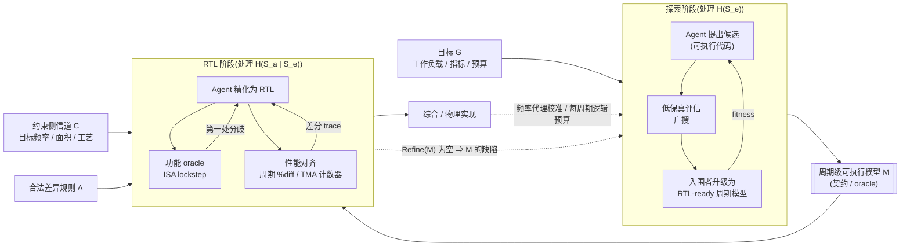

# 让 RTL 对模型精确：AI 时代架构探索与 RTL 生成的分界线

> 一个信息论记账模型、五个 CHIA 案例，以及几个可证伪的预测

## 一分钟摘要（TL;DR）

- **核心判断**：在 AI agent 时代，“自动架构探索”与“RTL 生成”应拆为两个课题，以**周期级可执行模型（cycle-level executable model，简称周期模型 $M$）**为契约——探索阶段把先验外的本质复杂性写成可执行代码 $M$，RTL 阶段以 $M$ 为 oracle 将其精化为 RTL。
- **为什么用代码交接**：代码不只是歧义系数更低，更在于“可执行”能把**沉默的歧义（silent ambiguity）**转化为协同仿真中**可检测的分歧（detectable divergence）**，把迭代修正的付费者从人类换成算力（功能层最强，性能层的限定见第 6.7 节）。
- **主动收窄**：高保真模拟太慢，工程上应采取多保真度级联——粗粒度模型广搜，入围候选升级为 RTL-ready 的周期模型作为**交付物**。
- **把方向倒过来**：在 agent 流程中应当**让 RTL 对模型精确**，并配合物理约束侧信道 $C$ 与合法差异规则 $\Delta$ 形成双向外环。
- **诚实边界**：当设计落入教科书先验区间且已有现成 ISA 级 oracle 时，端到端自然语言生成完全可行；唯有探索产出高新颖度微架构机制时，周期模型这座桥才不可替代。

---

## 0. 开篇：一个反直觉的判断

如果今天要让 AI agent 写出一块高性能处理器的 RTL，最好的输入不是一份详尽的自然语言需求文档，而是另一段代码；而这段代码，恰好应该由前一阶段的自动架构探索产出。

这个判断听起来违背直觉。近期备受关注的端到端硬件生成工作 Design Conductor [4]，正是从一份仅 219 词的自然语言需求文档出发，在 12 小时内自主生成了一颗可在 ASAP7 工艺下达到 1.48 GHz、被作者称为“Linux-capable”的 RISC-V 处理器。既然端到端已能走通，为什么还要在中间横插一层代码？

答案藏在 Design Conductor 团队自己的复盘里。作者在论文第 5.3 节坦言，输入规约必须写得“极其审慎、严密且可验证/可测量（verifiable/measurable）”——漏掉“CPI <= 1.5”这一行，agent 有时就会生成分支与前递性能显著退化的处理器；在第 6.2 节展望未来流程时，他们给出的判断是必须“把验证工作前置（front-load verification work）” [4]。到了处理规模扩大 80 倍的 Design Conductor 2.0，agent 为各模块编写 testbench 时干脆直接用参考 Python 实现来调试功能与逐周期行为 [5]。那么，当目标不再是教科书里的 5 级顺序流水线，而是探索全新的微架构机制时，那个“可测量、可验证”的规约应该从哪里来？

我的核心论点是：**在 agent 时代，“自动架构探索”与“RTL 生成”应当被当作两个问题来解，并以一个周期级可执行模型 $M$ 作为二者的契约。探索阶段负责在性能与成本代理的引导下，把模型先验覆盖不到的本质复杂性（essential complexity）写成可执行代码 $M$；RTL 阶段负责在以 $M$ 为 oracle 的机器可判定反馈下，把 $M$ 精化（refinement）为 RTL 实现 $R$，同时处理偶然复杂性（accidental complexity）与物理实现细节。**

为把这个判断算清楚，本文借用内部文档《智能体辅助编程的信息论价值模型》（下称“信息论价值模型”，后文引用的定理 4.1、命题 5.1 等均指该文档）的记账语言：令 $S$ 表示目标硬件设计的完整规约，$K = K_{\text{pretrain}} \cup K_{\text{RAG}} \cup K_{\text{context}}$ 表示人类与 agent 的共享先验，$H(S \mid K) = H(S) - I(S; K)$ 表示先验之外仍需跨通道传递的信息量。这里必须先做诚实声明：**这是一个记账模型，不是一个测量理论。** 单个设计的“熵”没有概率论定义；本文把 $H(\cdot)$ 当作描述长度意义上的记账单位，用来看清两条路线的相对成本落在哪里、由谁支付，而非给某个具体模块测算比特数。

下文第 1、2 节先界定为何拆分与周期模型 $M$ 的三重身份，第 3、4 节用信息论算清对齐机制与分治边界，第 5、6 节正面迎击 `gem5_align` 与时序耦合等反例，第 7、8 节则对照开源协同设计框架 CHIA [1] 的五个案例给出可证伪预测。

---

## 1. 两个问题，不是一个问题：为什么要拆

把架构探索和 RTL 生成混成“从需求直达 GDSII”的单阶段任务，首先在问题结构上就拧巴了。这两个阶段在目标函数、搜索空间、单次评估成本与验证判据上，都处在截然不同的量级（见表 A）。

| 维度 | 阶段一：自动架构探索 | 阶段二：RTL 生成与实现 |
|---|---|---|
| **核心问题** | 什么样的微架构机制在目标负载上最优？ | 如何把给定的周期行为忠实实现为可综合电路？ |
| **目标函数** | IPC、能效比、带宽利用率等（外加粗粒度面积/频率代理） | 功能精确等价 + 性能对齐 + 满足 PPA（时序、面积、功耗）硬约束 |
| **搜索空间** | 微架构策略与周期级状态机空间（队列深度、替换/预取算法、仲裁与背压规则） | 寄存器传输级实现空间（位宽、线网、多路器树、流水线握手机制、复位与时钟门控） |
| **评估器与速度** | 跟踪驱动或执行驱动模拟器（单次评估分钟至小时级，ChampSim 跑 10 亿条指令可超过 12 小时 [2]） | 逻辑仿真（Verilator 等，软件 KHz 级）+ 逻辑综合与静态时序分析（单次十数分钟至数小时） |
| **验证判据** | 统计意义上的性能增益（geomean speedup）与规则化的可实现性护栏 | 协同仿真（co-simulation, cosim）下的逐指令锁步（lockstep）与周期级容差检查 |
| **主要信息量** | 本质复杂性 $H(S_e \mid K)$（先验未覆盖的新机制） | 偶然复杂性 $H(S_a \mid S_e, K)$ + 跨边界物理约束 $C$ |

*表 A：自动架构探索与 RTL 生成两阶段的核心差异对照。*

为给“本质复杂性”和“偶然复杂性”一个可操作定义，令 $R$ 为一份具体 RTL 实现，$\mathcal{O}$ 为一组约定的**观测接口（observation interface）**（如指令提交流、每条提交指令的周期戳及微架构性能计数器），$h(R)$ 为 $R$ 在 $\mathcal{O}$ 上对所有输入程序表现出的周期级行为。若把设计的本质复杂性定义为周期行为等价类 $S_e := h(R)$，因 $S_e$ 是 $R$ 的确定性函数，由信息论链式法则有：

$$H(R) = H(R, h(R)) = H(S_e) + H(R \mid S_e).$$

这意味着，“本质复杂性加偶然复杂性等于总复杂性”不再是修辞比喻，而是严格的数学恒等式：凡在观测接口 $\mathcal{O}$ 上能区分出行为差异的决策，都属本质复杂性 $S_e$；给定周期行为 $S_e$ 后，$R$ 剩下的所有编码自由度——比如用独热码还是二进制码表示状态——全部落入条件熵 $H(R \mid S_e)$，即偶然复杂性 $S_a$。

**第一，搜索空间商化（quotienting）。** 假设探索阶段关心的性能指标 $J(R)$（如给定基准测试集上的几何平均 IPC）完全由 $\mathcal{O}$ 上的周期行为决定，即存在函数 $\tilde J$ 使 $J(R) = \tilde J(h(R))$。令周期模型 $M$ 代表某个行为等价类 $S_e$（$M$ 取遍 $h$ 的像集，即每个 $M$ 都至少有一份 RTL 实现），则优化问题满足：

$$\max_{R} J(R) = \max_{M} \tilde J(M).$$

这意味着，架构探索只需在规模为 $H(S_e)$ 的商空间里搜索，而不必在 $H(S_e) + H(R \mid S_e)$ 的 RTL 空间里搜索——直接在 RTL 空间做微架构探索，会把大量评估预算浪费在同一个周期模型 $M$ 的不同 Verilog/Chisel 写法上。

**第二，评估成本分层。** 设探索需评估 $N$ 个候选方案，从中筛出 $k \ll N$ 个入围方案进入硬件实现；周期模型单次评估成本为 $c_M$，RTL 跑通仿真与综合的评估成本为 $c_R$（且 $c_M \ll c_R$），agent 生成并调通一份可工作 RTL 的成本为 $g_R$。两路线总开销对比为：

$$\underbrace{N c_M + k\,(g_R + c_R)}_{\text{拆分}} \quad\text{vs}\quad \underbrace{N\,(g_R + c_R)}_{\text{在 RTL 上探索}}.$$

这意味着，拆分的收益不仅来自模拟器运行速度优势（$c_M \ll c_R$），更来自**不必为每个被淘汰的架构设想写出一份可工作的 RTL**（省去了 $(N-k)g_R$）。在 ArchAgent [2] 中，即使用高度简化的 ChampSim 跑完单次 10 亿条指令模拟，耗时也可超过 12 小时；若换到 RTL 层，香山（XiangShan）团队报告其软件 RTL 仿真速度仅为 KHz 量级，即便放上单块 FPGA 以 50 MHz 运行，跑完一轮 SPEC CPU2006 仍需超过 150 小时，单次迭代周期长达一周 [15]。当 $N$ 动辄成百上千时，把 $(g_R + c_R)$ 移出内层循环，是自动化探索在算力预算内成立的前提。

不过，上述推导有一个关键前提：**“本质”与“偶然”是相对目标函数而言的。** 对功能正确性和 IPC 来说，$H(R \mid S_e)$ 确实是偶然的；但对最高工作频率 $F_{\max}$ 和面积来说，对应同一个周期模型 $M$ 的不同 RTL 精化 $R$，关键路径延迟可能天差地别。CHIA [1] 时序优化案例中的“IPC-neutral（保持 IPC 不变）”提示词，就是在固定 $M$ 的前提下，只在精化集合 $\mathrm{Refine}(M) = \{R : R \models M\}$ 内部优化物理质量。一旦进一步收益需要通过微调流水线级数或牺牲少量 IPC 来换取两倍频率，频率就不再服从上面的商化假设。这个由处理器铁律（Iron Law）带来的物理耦合难题，留到第 5 节专门处理。

---

## 2. 桥为什么是周期级可执行模型：一份代码的三重身份

既然要拆，两阶段之间靠什么握手？我的答案是周期级可执行模型 $M$。

RTL 本身也是周期精确族里最精化的成员。为划清边界，我们把周期模型 $M$ 严格定义为：**在约定观测接口 $\mathcal{O}$ 上能够逐周期确定行为的最粗粒度可执行描述。** 它使用宿主语言（如 C++ 或 Python）的原生算术与抽象数据结构表示队列、表项和流水线资源占用，不需满足可综合子集限制，也不含线网、具体位宽编码、时钟树、复位网络或物理布局。形式上，$M$ 是 $R$ 在行为映射 $h$ 下的商代表元；当一份 RTL 实现 $R$ 在观测接口 $\mathcal{O}$ 上的行为 $h(R)$ 与 $M$ 一致（或满足约定的合法差异规则 $\Delta$）时，记作 $R \models M$，称 $R$ **精化**了 $M$。

在 PyMTL [18] 的功能层（FL）、周期层（CL）、寄存器传输层（RTL）三分法与事务级建模（TLM）谱系 [22] 中，$M$ 分别对应 CL 层与周期定时计算模型（cycle-accurate computation model）。但比分类更重要的是视角转换：**“周期精确”不是某个模型孤立的属性，而是两个制品之间的二元关系。** 传统流程先写 RTL 再让模拟器去逼近它，叫“模型对 RTL 精确”；而在本文提倡的 agent 流程里，$M$ 先于 $R$ 存在且本身就是契约，我们要做的是**让 RTL 对模型精确**。

选择周期模型 $M$ 作为桥，是因为同一份代码在跨越两阶段的生命周期里，天然扮演着三重身份（见表 B）：

| 身份 | 所在阶段 | 作用与输入/输出 | 解决什么痛点 |
|---|---|---|---|
| **1. 评估器（Evaluator）** | 探索阶段（入围期） | 输入工作负载，输出 $\mathcal{O}$ 上的 IPC 与微架构事件统计作为 fitness | 为编码 agent 提供可自动调用的闭环奖励信号 |
| **2. 交付物（Artifact）** | 探索与 RTL 交接处 | 固化了控制流、资源容量、冒险与背压规则的可执行源码 | 消除“用自然语言复述新发明的微架构机制”带来的歧义损耗 |
| **3. 规约与 Oracle** | RTL 生成与验证阶段 | 与 DUT 进行协同仿真，输出第一处功能分歧的周期与 PC，以及性能层的差分统计 | 把依赖人工编写期望值的开环验证，变成机器对机器的闭环精化检查 |

*表 B：周期级可执行模型 $M$ 在两阶段流程中的三重身份。*

在这里，我必须主动暴露并收窄本文最脆弱的一条子论点。如果声称“架构探索应当全程在 RTL-ready 的高保真周期模型上进行”，这个论点立刻会被两点推翻：一来，像 gem5 这样细节丰富的周期级模拟器比跟踪驱动模拟器慢得多，强行全程使用会严重扼杀探索广度；二来，现有架构探索工作（如 ArchAgent [2] 与 CHIA 的 `architectural-discovery-basic` 案例 [1]）普遍建立在 ChampSim 这类跟踪驱动（trace-driven）模拟器上，其产出的 C++ 策略代码既没有功能正确性概念，也缺乏硬件资源与时序语义。

因此，更站得住脚的表述是：**周期模型 $M$ 是架构探索的“最终交付物”，而不是探索全程唯一的“评估器”。** 工程上应当采用**多保真度级联（multi-fidelity cascade）**：外层用低成本的粗粒度模拟器（如短 trace 的 ChampSim 或参数化分析模型）做大范围候选淘汰；只有排名前列的入围设计，才在探索尾声被升级为结构完整、接口清晰的 RTL-ready 周期模型 $M$，跨过边界交给 RTL agent。

把这三重身份与多保真度级联拼在一起，就得到了本文主张的桥接架构（见图 1）。在这个双向外环中，探索阶段接收目标 $G$ 并交付 $M$；RTL 阶段在 $M$、物理约束侧信道 $C$（目标频率、面积预算、工艺节点）以及合法差异规则 $\Delta$ 的共同约束下生成并验证 RTL；而底层的时序与可实现性结果，又通过校准频率代理或报告“$\mathrm{Refine}(M)$ 为空”回流到探索阶段。



*图 1：以周期级可执行模型 $M$ 为契约的“自动架构探索—RTL 生成”双向桥接架构。*

---

## 3. 信息论视角：为什么代码是更好的对齐媒介

上一节定义了周期模型 $M$ 的三重身份，但为何向 RTL agent 传递意图时，可执行代码比自然语言规约更有效？用信息论价值模型拆解，背后有四个递进机制。

### 3.1 数据处理不等式：对齐的投入点在哪里

设原始意图为 $G$，探索产出周期模型 $M$ 与显式物理约束侧信道 $C$；RTL agent 在先验 $K$ 下只据 $(M, C)$ 生成 $R$，构成条件于 $K$ 的马尔可夫链 $G \to (M, C) \to R$。由**数据处理不等式（data processing inequality）**：

$$I(G;R\mid K)\le I(G;M,C\mid K).$$

这意味着 $R$ 对 $G$ 的对齐度不可能超过 $(M, C)$ 对 $G$ 的对齐度，由此给出两层洞察：

第一，**对齐的功夫应花在 $M$ 与 $C$ 上。** $(M, C)$ 是信息瓶颈，与其审查上万行 Verilog/Chisel，不如聚焦体量更小、可运行的 $M$ 与 $C$。

第二，**凡是 $M$ 不表达的意图，必须显式进入侧信道 $C$。** 上式成立的前提正是马尔可夫性 $I(G; R \mid M, C, K) = 0$。若 agent 同时读自然语言文档，该项大于零，上界失效——文档既可能补洞也可能与 $M$ 冲突，故工程上须遵守：**$M$ 是单一事实来源；自然语言只作注释；冲突时以 $M$ 为准，且冲突本身记为 $M$ 的缺陷。** 相应地，$M$ 不表达的 PPA、时钟/复位、DFT 与功耗意图若不入 $C$，RTL 阶段在信息上无法恢复——“PPA 从探索主干分离”即让 PPA 走侧信道 $C$，Design Conductor 2.0 发现人类审阅是主要瓶颈、唯一办法是“让人类设计者事先想清楚关键约束（PPA）” [5]，正是其印证。

### 3.2 重新定义 $\alpha$：从同义反复到可检验假说

信息论价值模型用 $\alpha \ge 1$ 表示自然语言的歧义开销，但直接令 $\alpha_{\text{code}} = 1$ 属同义反复。对通道 $X$，令接收消息 $x$ 后的残余歧义为 $A_X := H(S_e \mid x, K)$，将 $A_X$ 压至 $\delta$ 以下的最短消息长度为 $L_X(\delta)$，定义 $\alpha_X(\delta) := L_X(\delta) / H(S_e \mid K)$。

- 对周期模型 $M$：在 $\mathcal{O}$ 上运行代码即可确定“下一拍会怎样”，故 $A_M = 0$；$\alpha_M \ge 1$ 来自建模样板，**大致是不随精度变化的常数**。
- 对自然语言：**我的猜测（目前只有旁证）是，$\alpha_{NL}(\delta)$ 会随精度要求上升（$\delta \to 0$）而急剧上升。** 冒险、背压与仲裁的组合要求越精确，自然语言越冗长且不可靠：Design Conductor [4] 少写 CPI 一行就会生成分支与前递性能退化的核；LLM-FSM [10] 将 YAML 转为自然语言规约后，随状态机复杂度上升，最强 LLM 精度骤降；HLSPilot [11] 亦指出自然语言与硬件设计意图间存在“显著语义鸿沟”，转而用 C/C++ 配 HLS 缩小差距。

### 3.3 核心洞察：把沉默的歧义变成可检测的分歧

把通道 $X$ 的残余歧义——更准确地说，是接收方形成的解释与 $S_e$ 的残余偏差——按“能否被现有 oracle 在激励下暴露”拆为可检测与沉默两部分：

$$A_X = A_X^{\text{detect}} + A_X^{\text{silent}}.$$

这意味着，代码的优势不只是“更少歧义”，更是**把沉默的歧义变成可检测的分歧**；设计观测接口 $\mathcal{O}$ 与激励覆盖率，就是在设计 $A^{\text{silent}}$ 的上界。

自然语言通道缺乏可执行 oracle，agent 会静默选定一种解释，残余偏差几乎全是 $A_{NL}^{\text{silent}}$，到后端才以深层 bug 暴露——Zhang 等人 [13] 亦将“规约歧义（ambiguous specifications）”列为 LLM 生成 RTL 的主要失败根因。相反，用可执行 $M$ 做协同仿真时，信息歧义 $A_M = 0$，只剩 agent 误读或误实现 $M$ 的偏差：凡改变 $\mathcal{O}$ 上行为的偏差均暴露为可检测分歧，沉默部分只剩“激励未覆盖输入”上的偏差；而“$\mathcal{O}$ 之外的行为”按定义不在 $S_e$ 内，须经 $C$ 与 $\Delta$ 显式交代。这与无可执行规约时的防歧义机制同构：CHIA 的 CIRCT 案例 [1] 在合理修复方案 $>1$ 且无依据时（$H(\text{fix} \mid \text{issue}, K) > 0$）返回 `UNCLEAR` 拒绝盲改，ClarifyGPT [12] 则用多候选代码不一致检测歧义并提问。

### 3.4 新颖性把自然语言推入悖论区间

探索产出的新机制 $S_e^{\text{new}}$ 按定义是先验未覆盖的（$I(S_e^{\text{new}}; K) \approx 0$）。由信息论价值模型的定理 4.1 与推论 4.2（悖论区间），对任意 $\alpha_{NL} > \alpha_M$（原模型默认代码侧 $\alpha = 1$），用自然语言传递该部分的成本必高于直接写代码；若新机制是已知部件的新组合（$I(S_e; K) > 0$），定义新颖比例 $\rho = H(S_e \mid K) / H(S_e)$，结论随 $\rho$ 增大而单调增强。**架构探索的产出，恰恰是模型先验覆盖不到的那部分；而这正是自然语言对齐必然亏本的区间——所以它只能以代码交付。** 况且探索本就把候选方案写成了模拟器代码，直接交接 $M$ 的边际成本极低。

### 3.5 信息守恒，付费者变了

信息论价值模型（命题 5.1）记第 $t$ 轮修正 $m_t$ 的信息量为 $H(m_t) := H(S \mid K, m_{<t}) - H(S \mid K, m_{\le t})$——严格说这是条件互信息 $I(S; m_t \mid K, m_{<t})$，收敛时伸缩求和得 $\sum_t H(m_t) = H(S \mid K)$。本文沿用该记号，按记账口径读作“每轮至少必须传输的信息量”（若有冗余则描述长度更大）。将 $m_t$ 拆为 oracle 生成的 $m_t^o$ 与人工编写的 $m_t^h$，由链式法则，$H(m_t)$ 拆为 $m_t^o$ 消除的部分与“看过 $m_t^o$ 后”$m_t^h$ 再消除的部分 $H(m_t^h)$：

$$m_t = (m_t^h, m_t^o), \qquad E_{\text{human}} = \sum_t H(m_t^h).$$

这意味着，**迭代对齐的总信息量是守恒的；可执行模型改变的是谁来付费：把人写的修正描述，换成机器算出的第一处分歧。** 人类开销只取决于机器无法代劳的 $m_t^h$（$E_{\text{human}}$ 是人工描述长度的下界）：有了 $M$ 作 oracle，“RTL 哪里不对”由高带宽的 $m_t^o$（第一处分歧的周期与 trace）承担、由算力买单，人只支付 $C$ 与 $\Delta$。CHIA 的 `riscv_extensions` 案例 [1] 中，Spike 编译进仿真器做数百万条 `riscv-dv` 随机指令的 lockstep，文档写道 **“No expected output is ever hand-encoded — the golden model is the check”**（无需手写期望输出——黄金模型本身就是检查）；分歧当拍即被捕获，作为 $m_t^o$ 交给 debug LLM 修复 RTL。

```text
         自然语言路线                         周期模型路线
人写:   规约 α_NL·H(S_e|K)                 人写/审:  M(≈H(S_e|K),常为探索副产品)
人写:   每轮修正 m_t^h                      人写:     C⁺ 与 Δ(因拆分而须额外说出的东西)
人写:   testbench 期望值 V_NL               机器生成: 第一处分歧 m_t^o(带宽≫人)
歧义:   大部分沉默 A^silent                 歧义:     大部分可检测 A^detect
```

*图 2：谁来付费——自然语言路线与周期模型路线的成本与歧义对比。*

---

## 4. 把账算全：分治什么时候更划算

当然，周期模型 $M$ 并不便宜——据 CHIA 论文，对齐后的 gem5 核相对基线有 1,520 行 diff [1]。为算清分治何时划算，比较两条路线在 RTL 阶段的人类信息成本（偶然复杂性 $S_a$ 的先验补全与公共基本 PPA 目标 $H(C_0)$——如“CPI $\le 1.5$、目标 1.6 GHz”，$\alpha \approx 1$——两边相消）：记直接路线人工编写 testbench 期望值与断言的检查成本为 $V_{NL}$，分治路线因拆分而须额外跨边界的约束信息（每周期逻辑预算、物理反馈、工艺代理）为 $H(C^{+}) = H(C_{\text{split}}) - H(C_0) \ge 0$，显式写出合法差异规则 $\Delta$ 的成本为 $H(\Delta)$。

直接路线成本为 $E_{\text{direct}} \approx \alpha_{NL} H(S_e \mid K) + V_{NL} + H(C_0)$；分治路线分**情形 A（$M$ 为探索副产品）** $E_{\text{split}} \approx c_{\text{ready}} + H(C^{+}) + H(\Delta) + H(C_0)$（$c_{\text{ready}}$ 为升级至 RTL-ready 周期模型的代价）与**情形 B（专门写 $M$）** $E_{\text{split}} \approx H(S_e \mid K) + H(C^{+}) + H(\Delta) + H(C_0)$。在更严苛的情形 B 下（取 $\alpha_M \approx 1$；若计建模样板，左端首项改 $(\alpha_{NL}-\alpha_M)H(S_e\mid K)$，结论不变），分治更划算当且仅当：

$$(\alpha_{NL}-1)\,H(S_e\mid K)+V_{NL}\;>\;H(C^{+})+H(\Delta).$$

这意味着分治边界由四项信息量决定，可直接读出三条推论：
1. **新颖性越高越该分治**：左端随先验未覆盖的 $H(S_e \mid K)$ 线性增长。
2. **同一不等式也解释了 Design Conductor [4] 为何成功**：教科书级 5 级流水线使 $H(S_e \mid K)$ 极小，现成 Spike oracle 使 $V_{NL}$ 极小，左端趋近于零，直接从自然语言生成 RTL 本就划算。框架同时解释了正反两种结果——当然，这只是事后的一致性，真正的检验是第 8 节的 P1–P3。
3. **分治的真实成本是“因为拆开而必须额外说出的东西”**：即 $H(C^{+}) + H(\Delta)$；物理耦合越强、合法周期级不确定性越多，分治优势越小。

在情形 A 下，$M$ 看似免费，**但若探索在 trace 驱动的 ChampSim 等低保真评估器上进行，$c_{\text{ready}}$ 就会接近一次 `gem5_align` 的代价**——这正是第 2 节收窄为“多保真度级联”的原因。

最后计入机器成本 $E_{\text{total}} = E_{\text{human}} + \lambda\,C_{\text{machine}}$（$\lambda$ 为算力/token 相对人力的价格）。分治把成本从人转给机器（据 CHIA 论文，cosim 占 `riscv_extensions` 总机时的 50%–66% [1]），故**我的猜测（目前只有旁证）是：随 $\lambda$ 下降，分界线将向分治移动。** 但我的判断是，这是双刃剑：$\lambda$ 下降与 FPGA 加速（如 FireSim）同样会压低第 1 节的 $g_R$ 与 $c_R$。CHIA 论文自己就指出，可将设计放到 FireSim 上获得更高保真度的反馈（第 5.4.1 节），并在第 5.4.3 节勾勒了以 Verilator、FireSim、Hammer 级联为评估器、直接在 RTL 上做演化探索的流程 [1]——这恰是我在第 1 节反对的路线。我不认为二者冲突：RTL 级评估器适合做级联的末级，而跨阶段交付的契约仍应是 $M$。也正因如此，分治的长期优势应主要靠第 3 节的信息论论证，而非成本论证。

---

## 5. 最强的两个反例：gem5 对齐与 Iron Law

CHIA [1] 的五个案例里，有两个正面挑战了本文假设：耗时 10.5 天的 `gem5_align` 与揭示频率—IPC 耦合的时序优化。摊开它们、看清论点收窄到了哪里，比单边辩护更有价值。

### 5.1 gem5 对齐为什么贵——方向反了

第一个质疑：**在 CHIA 的 `gem5_align` 案例里，光让 gem5 对齐现成的 MediumBOOM 就让 agent 跑了 10.5 天，这难道不直接推翻“让架构探索交付周期精确模型”的可行性吗？**

我承认周期级模型与 RTL 的对齐极贵 [20]：香山（XiangShan）团队报告，粗对齐的 gem5 在 SPEC CPU2006 上比实际 RTL 低约 30%，企业不得不设独立团队对齐 RTL [15]；据 CHIA 论文，agent 在 2-wide MediumBOOM 上历经 202 次迭代（约 10.5 天），虽在 36 个 Microbench 训练基准上将平均周期误差压到 $<3\%$，但留出集 Embench IOT 2.0 最佳迭代平均误差仍在 $<7\%$ 且有离群点，还出现针对训练基准调参的阈值 `kSuppressThreshold` 令留出集 Wikisort 恶化的过拟合 [1]。

症结在于：`gem5_align` 之所以这么贵、甚至过拟合，是因为方向反了。**让模型去追 RTL 是逆向工程，误差主要来自“不知道硬件到底怎么做”；让 RTL 去追模型是精化检查——这在 ISA 层早已是工业标准，现在该把它推到周期层了。** `gem5_align` 先有写死的复杂乱序核 RTL，再让模拟器去猜其周期行为；Gutierrez 等人在用 gem5 对照 Cortex-A15 真实硬件的研究中指出，三类误差里**规约误差（specification error，即建模者不了解或必须猜测目标硬件的具体行为）是主导误差源** [14]。而在本文流程里，周期模型 $M$ 先于 RTL 存在且**本身就是规约**：Gutierrez 意义上的规约误差消失了，但转化成了 $M$ 自身是否正确、是否可实现的问题（见第 6 节）；对 RTL 阶段而言，问题变成验证 $R \models M$。回顾验证史，ISA 层早已走通此路（CHIA `riscv_extensions` 用 Spike 做逐指令 lockstep [1]、香山 DiffTest 比对可执行模型 NEMU [15]、Arm 将可执行 ASL 规约机械翻译为 Verilog 落地 8 款处理器的 ISA-Formal [16]）。

据此我把论点收窄为：**本文主张把“RTL 追可执行规约”从 ISA 层推到周期层；至于周期层的“RTL 追模型”是否同样显著比“模型追 RTL”便宜，是我的猜测（目前只有误差源归因与 ISA 层先例作旁证），留待第 8 节 P2 检验。** 同时，若把 `gem5_align` 倒过来跑，它用 O3PipeView 流水线 trace 按 PC 对齐比对 gem5 退休周期与 Verilator 提交周期、配合 BOOM TMA 计数器对照 `stats.txt` 的诊断信号 [1]，恰好就是 RTL 阶段做 $M \leftrightarrow R$ 性能对齐的现成工具链；而且单个 agent 用约 10.5 天、约 \$2,356 API 成本（据 CHIA 论文 [1]）就基本做成了过去“对大团队也是巨大工作量” [1] 的事，说明双向对齐成本都在快速下降。

### 5.2 Iron Law 耦合

第二个反例直击第 1 节的伏笔：**处理器性能受铁律（Iron Law，$\text{Time} = \text{Instructions} \times \text{CPI} \times \text{Cycle Time}$）支配，周期模型 $M$ 不含门级延迟与面积，脱离物理实现探索难道不会失真吗？**

耦合确实存在。据 CHIA 论文，时序优化案例在前 4 次“IPC-neutral（不影响 IPC）”迭代后陷入平台化，团队随即切换到 Iron Law 模式（牺牲少量 IPC 换取关键路径缩短），最佳迭代（第 7 次）频率相对基线约为 $2.03\times$（约 47 MHz $\to$ 95 MHz）[1]；论文没有拆分两阶段各自的贡献，但能确定：**IPC-neutral 走不动之后，继续前进需要改变 $M$**。同样，ArchAgent [2] 承认因缺乏频率与面积数据，确认可实现性高度依赖人工（从微架构模型推断物理存储大小并不平凡）；且据 CHIA 论文，Sky130 上的改进放到商用 16nm 下，仅第一项（发射队列从线性深度改为对数深度，改善关键路径约 $70\%$）泛化，其余均不泛化 [1]。

为此，我将两阶段解耦收窄为三条工程边界：

1. **探索中引入误差有界的 PPA 代理（频率代理 $\hat f$ 与面积模型）**：在 $M$ 中显式约束“每周期逻辑预算”并配误差有界的 $\hat f$，选出模型的性能损失比即有严格上界（见附引理）。Agentic Architect [3] 结合周期精确模拟与硬件成本模型，在面积/功耗预算下以 TAGE-SC-L $10.58\%$ 的面积达其 $97.62\%$ 的 IPC，正是实例。
2. **桥是双向外环（见图 1）**：综合暴露关键路径无法在固定 $M$ 下收敛时，物理瓶颈经 $C^+$ 回流修改 $M$。
3. **工艺信息不固化进 $M$，而作可替换的 $\hat f$ 与 $C$**：16nm 不泛化说明 $M$ 应保持工艺无关，换工艺只替换 $\hat f$ 与 $C$。

> **附：代理引理（可跳过）**
> 设 $\mathrm{Perf}(M,R)=\mathrm{IPC}(M)\cdot f(R)$，$f^*(M)=\max_{R\in\mathrm{Refine}(M)}f(R)$。若频率代理 $\hat f$ 在候选集上满足 $\ln\hat f(M)=\ln f^*(M)+b+e(M)$（常数偏置 $b$ 任意，$|e(M)|\le\varepsilon$），则按 $\mathrm{IPC}(M)\cdot\hat f(M)$ 选出的 $\hat M$ 相对真实最优 $M^*$ 满足：
> $$\frac{\mathrm{IPC}(M^*)f^*(M^*)}{\mathrm{IPC}(\hat M)f^*(\hat M)}\le e^{2\varepsilon}.$$
> **证明**：由条件有 $f^*(\hat M)\ge\hat f(\hat M)e^{-b-\varepsilon}$、$\hat f(\hat M)\mathrm{IPC}(\hat M)\ge\hat f(M^*)\mathrm{IPC}(M^*)$ 及 $\hat f(M^*)\ge f^*(M^*)e^{b-\varepsilon}$，三步串联消去 $b$ 即得：$\mathrm{IPC}(\hat M)f^*(\hat M)\ge \mathrm{IPC}(\hat M)\hat f(\hat M)e^{-b-\varepsilon}\ge \mathrm{IPC}(M^*)\hat f(M^*)e^{-b-\varepsilon}\ge \mathrm{IPC}(M^*)f^*(M^*)e^{-2\varepsilon}$。这意味着探索无需预测绝对主频，只需一个**在常数倍意义下误差有界**（$\varepsilon$ 小，$b$ 无所谓）的相对代理。

不过，代理引理是条件性的——它说“若有好代理则够用”，并未保证好代理存在；16nm 不泛化说明 $\varepsilon$ 可能很大，若校准 $\hat f$ 必须综合 RTL，综合又回到了内环（见第 8 节下一步中的频率代理校准实验）。反过来，IPC-neutral 模式与 `timing_experiment` 子模块 A/B 综合 [1] 也支持了拆分：固定 $M$、在 $\mathrm{Refine}(M)$ 内做垂直物理优化，本身就是独立子问题（见图 3）。

```text
  最高频率 f*(M)
    ^
    |        . '              . '
    |     . '  [M2: Iron Law 模式]
    |  . '        *  <-- 斜向移动: 改变 M (微降 IPC, 最终达 ~2.03x 基线频率)
    |              \
    |               \  . '
    |                * '  <-- [M1: IPC-neutral 平台期]
    |                ^
    |                |  垂直移动: 固定 M, 在 Refine(M) 内优化 RTL
    |                *  <-- [M1: 初始 RTL]  (虚线: 等性能曲线 IPC·f* = const)
    +---------------------------------------------------------> IPC(M)
```

*图 3：在 $\mathrm{IPC}(M)$–$f^*(M)$ 平面上看时序优化：固定 $M$ 的垂直优化与改变 $M$ 的斜向跃迁。*

---

## 6. 其他几个值得认真对待的质疑

除上述两例，另有七个质疑值得按“承认—收窄—证据”回应。

### 6.1 为什么不直接 NL→RTL？
**承认与收窄**：Design Conductor [4, 5] 展示了端到端潜力，但如第 4 节不等式所示，直接路线在教科书级流水线上本就划算；对新颖微架构，用自然语言传递本质复杂性则在信息上必然亏本（第 3.4 节）。**证据**：离开教科书区间后，CVDP [7] 上 SOTA pass@1 $\le 34\%$，ChipBench [6] 上 Claude-4.5-opus 的 Verilog 生成仅 $30.74\%$，错误归因研究 [13] 亦指规约歧义为主因；故 Spec2RTL-Agent [8] 先生成可综合 C++（人工干预减少至多 $75\%$），FormalRTL [9] 用软件参考模型作可执行规约。

### 6.2 LLM 写周期模型本身也会幻觉
**承认**：ChipBench [6] 显示 Claude-4.5-opus 生成 Python 参考模型 pass@1 仅 $13.33\%$（摘要口径；贡献列表作 $15.93\%$，结果表中 $15.93\%$ 对应 Claude 4.5 Sonnet），低于其 Verilog 的 $30.74\%$；且我检索范围内未见专门做 LLM 自动生成 gem5/周期级模拟器的工作。$M$ 亦有功能与“不可实现/作弊”幻觉，如 ArchAgent [2] 的 simulator escape（被优化消除的 assertion 令旁路写消失，虚增 $3\%\text{–}4\%$ 性能）。**收窄**：ChipBench 的任务方向是“从自然语言追隐藏 golden”，低分既可能来自能力不足（作者自己的归因：缺乏硬件行为建模知识），也可能来自自然语言歧义，二者无法从其数据中分离；本文中 $M$ 由探索选出、本身即定义。**证据**：对执行驱动的核级 $M$，功能幻觉可用 Spike 等 ISA 级 oracle 自检（trace 驱动的预取器/替换策略模型没有功能语义，ArchAgent 原话“no notion of ‘correct computation’” [2]）；不可实现与作弊靠受限建模语言/接口（Kôika [19]、Assassyn [17]）配规则化 verifier（如代码行数上限 [2]），并以 **RTL 阶段作最终可实现性检查**（$\mathrm{Refine}(M)$ 为空则回流）。

### 6.3 这不就是业界现状吗？
**承认**：正交化关注点 [23]、TLM [22]、PyMTL 的 FL/CL/RTL [18] 与独立性能模型团队 [15] 早有先例。**收窄与证据**：本文新在两点——**角色与方向**：现状中模拟器按 Nowatzki 等定义是“不依赖 RTL 规约”的估算器 [21]，常滞后失准；本文中 $M$ 是前置契约，机械检查 $R \models M$。**成本结构**：agent 压低了精化与对齐成本，使 ISA 层做法得以推向周期层。

### 6.4 单源方案已让模拟器与 RTL 天然对齐，桥是否多余？
**承认**：Assassyn [17] 用统一抽象同时生成对齐的周期精确模拟器与 RTL，相当于 $c_{\text{ready}} \to 0$。**收窄与证据**：这反印证**桥就在周期级**。但探索受限于硬件 DSL：其模拟器速度贴近 Verilator，gem5 在长负载上再快一个数量级 [17]；且 DSL 语料远少于 C++/Python（旁证：Design Conductor 见模型把 Verilog 当顺序代码推理，归因于软件语料占主导 [4]）。故**拆的是“探索”与“精化”两个问题，未必是两份制品**。

### 6.5 逐周期严格一致会把 RTL 绑死，合法差异怎么办？
**承认**：死守逐拍严格相等会封死物理优化空间——IPC-neutral 模式的平台化即旁证 [1]。**收窄与证据**：香山 DRAV 指出“在设计规约下，不同微架构产生不同结果可能是合法的（different outcomes under diverse micro-architectures may be legal under the design specifications）”，故用差异规则建立 DUT 与 REF 的 $N$ 对 $1$ 对应 [15]。同理，本文 oracle 分为**功能层精确 + 性能层在规则/容差内一致**，显式建模 $\Delta$，并将 $H(\Delta)$ 与 $H(C^+)$ 计入第 4 节成本项。

### 6.6 方向翻转是否只是把逆向工程挪到了 $c_{\text{ready}}$ 这一步？
**承认**：情形 A 中若探索产出的是 ChampSim 式 trace 驱动代码（现有工作的常态 [1, 2]），它没有时序与功能语义；升级为 RTL-ready 周期模型必须**补写**原本不存在的周期行为，这本身是在猜“这个机制在真实流水线里会怎么表现”，规约误差 [14] 只是被转移而非消失。**收窄**：第 5.1 节的方向论证只在 $M$ 被直接写出（情形 B，或探索本就在周期模型上进行）时干净；对这种情形 A，我把第 8 节 P3 设计成能检验 $c_{\text{ready}}$ 步骤的误差。

### 6.7 周期层的第一处分歧是否远不如 ISA 层有信息量？
**承认**：ISA lockstep 有效是因为提交时的架构状态有规范对齐点；周期层一旦允许 $\Delta$，两条轨迹在第一次合法偏移后就失去逐拍对齐，“第一处分歧”可能只是合法差异的连锁反应，不是 bug，$m_t^o$ 的信息量与 $H(\Delta)$ 此消彼长。**收窄**：第 3.5 节的“付费者转移”强结论限定在功能层；性能层 oracle 只能做统计/计数器级定位（`gem5_align` 的周期误差百分比 + TMA [1] 正是这种形态）。

---

## 7. CHIA 五个案例：证据与证据之外

把前文模型放回真实系统检验，CHIA [1] 的五个案例恰好提供了一组正反兼备的切片（见表 C）。

| 案例 | 它支持什么 | 它没有检验 / 挑战什么 | 一个关键事实 |
|---|---|---|---|
| **架构发现**（`architectural-discovery-basic`） | 候选即 C++ 可执行代码，fitness 由模拟器给出；三函数接口（`build_fn` / `run_fn` / `result_mapper_fn`）支持替换评估器 | ChampSim 为 trace 驱动，产出**不是 RTL-ready 周期模型**（据 CHIA 论文，亦无功耗、面积与关键路径反馈）；无 RTL 落地 | 简化版跑 3 条 SPEC CPU 2017 trace，10 次迭代 1 小时内完成 [1]（沿用 ArchAgent [2] 范式） |
| **gem5 对齐**（`gem5_align`） | 能产出对齐 RTL 的周期模型；O3PipeView 按 PC 比对与 BOOM TMA 对照构成 $M \leftrightarrow R$ 性能对齐蓝本 | 挑战对齐成本假设；方向是“模型追 RTL”逆向工程，**未检验“RTL 追模型”**，且对训练基准过拟合 | MediumBOOM 上跑 10.5 天，训练集平均周期误差 $<3\%$，留出集 Embench IOT 2.0 最佳迭代 $<7\%$ 且有离群（据 CHIA 论文）[1] |
| **RISC-V 扩展**（`riscv_extensions`） | **可执行规约作 oracle 与付费者转移的最强证据**：Spike 逐指令 lockstep，无手写期望输出；分歧当拍捕获作 $m_t^o$ 驱动修复；指令覆盖率按构造为 $100\%$ | 只是 **ISA 级功能 oracle**，不是周期级性能 oracle；实现已批准扩展，未涉及新微架构探索 | MegaBOOM 上实现 Bitmanip、标量密码与 Zicond 三项扩展（据 CHIA 论文分别仅需 2 / 6 / 1 次 LLM 迭代，FireSim 跑通 25+ 万亿条指令），无时序回退 [1] |
| **时序优化**（`timing-optimization`） | IPC-neutral 提示词表明“固定 $M$、在 $\mathrm{Refine}(M)$ 内优化物理质量”独立可解；`timing_experiment` 支持子模块 A/B 综合 | 挑战单向解耦：Iron Law 耦合使 IPC-neutral 平台化之后的进一步收益必须改变周期行为 $M$；未必跨工艺泛化 | Sky130 下 15 次迭代频率提升 $>2\times$、净性能 $1.97\times$；据 CHIA 论文，16nm 下仅第一项优化泛化 [1] |
| **CIRCT issue**（`circt-issue-solving`） | **歧义显式化**：合理解法 $>1$ 且无依据时报 `UNCLEAR`；`repro.sh`（“exit 0 iff fixed”）作可执行规约，`verify` 无 LLM | 属编译器修复，与周期模型无直接对应，仅提供方法论同构证据 | 评估 16 个 issue，5 个可复现且方案明确的全部解决（据 CHIA 论文，4 个因多种合理解法判 Fix unclear）[1] |

*表 C：CHIA 五个案例与本文论点的证据映射。*

连看这五个切片，有三条主线：

第一，`riscv_extensions` 把第 3.5 节的“付费者转移”做成了全自动通道：人只提供扩展规约与结构化指令表，驱动 RTL 收敛的修正全部来自 Spike 逐指令比对吐出的第一处分歧 trace（据 CHIA 论文，修复代码的 LLM 对底层验证设施一无所知，只接收必要 trace [1]）。文档原话点破了本质：**“the flow verifies a BOOM implementation, it doesn't invent the ISA”**（该流程验证的是 BOOM 的实现，它并不发明 ISA）[1]——“发明规约（探索）”与“忠实实现（精化）”在此本来就是拆开的，未竟之业正是把这套机制从 ISA 级功能 oracle 推向周期级性能 oracle。

第二，CIRCT 案例在合理解法不止一种时强制报 `UNCLEAR`（据 CHIA 论文源于早期对 issue #8508 修法各执一词 [1]），与本文用 $(M, \Delta)$ 显式区分必对齐行为与合法周期差异、不留沉默歧义遵循同一底线。

第三，我绝不会把五个案例写成“都支持我”：架构发现尚未跨到周期模型，而 `gem5_align` 与时序优化恰恰暴露了对齐成本与 Iron Law 耦合，逼出了前文关于多保真度级联、方向翻转与双向外环的全部收窄。

---

## 8. 可证伪的预测与下一步

围绕核心论点与收窄后的假说，我给出四条可证伪预测：

- **P1（对齐媒介对比）**：对同一新颖微架构特性做 A/B 对照，比较向 RTL agent 提供“周期模型 $M$ + 协同仿真 oracle”与“等价自然语言规约 + 常规测试”，观测达到功能正确且周期误差 $\le$ 阈值的人类干预次数与算力成本。**若两者人类干预成本无显著差异，则第 3 节“可执行代码将沉默歧义转为可检测分歧并转移付费者”的强论点被否证。**
- **P2（对齐方向性对比）**：对同一微架构与周期模型（如 MediumBOOM），在同基准与算力下比较“RTL 追模型”（以给定 $M$ 指导改 RTL）与 `gem5_align` 的“模型追 RTL”，观测达到相同训练误差（如 $<3\%$）的迭代次数与留出集（如 Embench）泛化退化。**若前者迭代次数或留出集退化不优于后者，则第 5.1 节“规约误差主导导致逆向工程更贵”的方向性假说被否证。**
- **P3（多保真度级联与 $c_{\text{ready}}$ 误差检验）**：对比三类 top-$k$ 候选——（a）ChampSim 等 trace 驱动探索直接交 RTL 落地、（b）trace 驱动探索后经 $c_{\text{ready}}$ 补写升级为 RTL-ready 周期模型 $M$、（c）直接在“$M$ + 误差有界的 PPA 代理”上探索——统一经 Chipyard + Hammer 综合，观测排名保持率及 PPA 预算下的存活比例。**若（a）与（b）（c）存活率相当，则第 2、5.2 节级联收窄被否证；若（b）因 $c_{\text{ready}}$ 补写引入显著规约误差、存活率远低于（c），则第 6.6 节“情形 A 只是把逆向工程挪到 $c_{\text{ready}}$”的质疑得到支持，探索须直接下沉到 $M$。**
- **P4（趋势判断）**：观察未来一至两年 CVDP [7]、ChipBench [6] 后续版本是否增设“可执行参考模型输入”赛道并拉开相对纯自然语言赛道的 pass@$k$ 差距；若否，则复杂硬件对齐媒介向代码迁移的趋势判断被否证。

在 CHIA [1] 底座上搭起这座桥，下一步有四件事：
1. **替换探索尾声评估器**：利用 `architectural-discovery-basic` 的 `build_fn` / `run_fn` / `result_mapper_fn` 接口，在 ChampSim 广搜后接入周期模型作入围候选升级与交付通道。
2. **倒接 `gem5_align` 工具链**：复用按 PC 对齐的 O3PipeView 比对与 TMA 计数器对照，改造为检验 $R \models M$ 的自动诊断生成器。
3. **定义受限接口与 $\Delta$ 规范**：在 $M$ 中强制声明容量、端口与每周期逻辑预算（堵住 ArchAgent [2] 式 simulator escape），并设计合法周期差异语法 $\Delta$。
4. **校准频率代理并量化 $\varepsilon$**：基于时序优化数据，在 Sky130 与另一工艺上做成对综合，拟合频率代理 $\hat f$ 并实测第 5.2 节引理中的最大相对误差 $\varepsilon$。

如果要把整篇文章压缩成三句话带走，那就是：

> - **架构探索真正有价值的产出，恰恰落在模型先验覆盖不到的盲区；那正是自然语言对齐必然亏本的区间——所以它只能以可执行代码交付。**
> - **多轮迭代对齐的总信息量是守恒的；可执行模型改变的不是信息总量，而是谁来买单：把人类手写的修正描述，换成机器在协同仿真中抓出的第一处分歧。**
> - **让模型去追 RTL 是逆向工程，误差主要来自“猜不准硬件到底怎么做”；让 RTL 去追模型是精化检查——这在 ISA 层早已是工业标准，现在该把它推到周期层了。**

回到开篇的问题：当 AI agent 让写代码越来越便宜，硬件研发真正的瓶颈不再是敲出代码的速度，而是如何以最低歧义成本把“要做什么”交代清楚并验证通过。与其写完 RTL 再花十几天逆向校准迟到的模拟器，不如从一开始就把方向倒过来——让架构探索交付一段可执行的周期模型，再让 RTL 对模型精确。

---

## 参考文献

[1] Cui, Hermida-Rivera, Toubes 等. *CHIA: An open-source framework for principled, agentic AI-driven HW/SW co-design research*. 2026. https://arxiv.org/abs/2606.27350
[2] Gupta 等. *ArchAgent: Agentic AI-driven Computer Architecture Discovery*. 2026. https://arxiv.org/abs/2602.22425
[3] Kypriotis, Blasberg, Moiras, Skarlatos. *Agentic Architect*. 2026. https://arxiv.org/abs/2604.25083
[4] Verkor Team. *Design Conductor*. 2026. https://arxiv.org/abs/2603.08716
[5] Verkor Team. *Design Conductor 2.0*. 2026. https://arxiv.org/abs/2605.05170
[6] Yu 等. *ChipBench*. 2026. https://arxiv.org/abs/2601.21448
[7] Pinckney 等. *CVDP: Comprehensive Verilog Design Problems*. 2025. https://arxiv.org/abs/2506.14074
[8] Yu 等. *Spec2RTL-Agent*. 2025. https://arxiv.org/abs/2506.13905
[9] Li 等. *FormalRTL*. 2026. https://arxiv.org/abs/2603.08738
[10] Wu 等. *LLM-FSM*. 2026. https://arxiv.org/abs/2602.07032
[11] Xiong, Liu, Li, Li. *HLSPilot*. 2024. https://arxiv.org/abs/2408.06810
[12] Mu 等. *ClarifyGPT*. 2023. https://arxiv.org/abs/2310.10996
[13] Zhang 等. *Understanding and Mitigating Errors of LLM-Generated RTL Code*. TCAD, 2025. https://arxiv.org/abs/2508.05266
[14] Gutierrez 等. *Sources of Error in Full-System Simulation*. ISPASS, 2014. https://doi.org/10.1109/ISPASS.2014.6844457
[15] Xu 等. *Towards Developing High Performance RISC-V Processors Using Agile Methodology*. MICRO, 2022. https://doi.org/10.1109/MICRO56248.2022.00080
[16] Reid 等. *End-to-End Verification of ARM Processors with ISA-Formal*. CAV, 2016. https://alastairreid.github.io/papers/CAV_16/
[17] Weng 等. *Assassyn*. ISCA, 2025. https://doi.org/10.1145/3695053.3731004
[18] Lockhart, Zibrat, Batten. *PyMTL*. MICRO, 2014. https://doi.org/10.1109/MICRO.2014.50
[19] Bourgeat, Pit-Claudel, Chlipala, Arvind. *The Essence of Bluespec (Kôika)*. PLDI, 2020. https://doi.org/10.1145/3385412.3385965
[20] Black, Shen. *Calibration of Microprocessor Performance Models*. IEEE Computer, 1998. https://doi.org/10.1109/2.675637
[21] Nowatzki 等. *Architectural Simulators Considered Harmful*. IEEE Micro, 2015. https://doi.org/10.1109/MM.2015.74
[22] Cai, Gajski. *Transaction Level Modeling: An Overview*. CODES+ISSS, 2003. https://doi.org/10.1145/944645.944651
[23] Keutzer, Malik, Newton, Rabaey, Sangiovanni-Vincentelli. *System-level design: orthogonalization of concerns and platform-based design*. IEEE TCAD, 2000. https://doi.org/10.1109/43.898830
