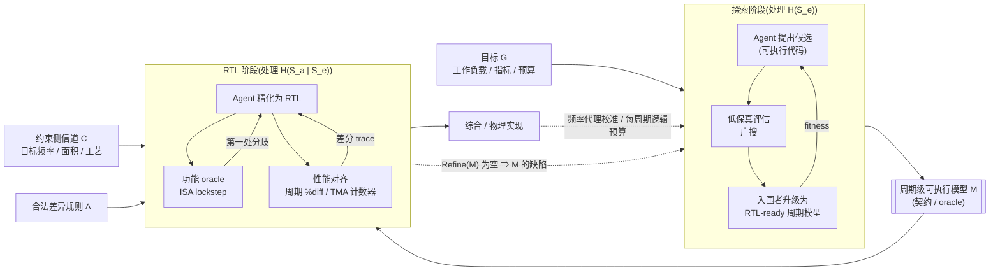

# 让 RTL 对模型精确：AI 时代架构探索与 RTL 生成的分界线

> 一个信息论记账模型、五个 CHIA 案例，以及几个可证伪的预测

## 一分钟摘要（TL;DR）

- **核心判断**：在 AI agent 时代，“自动架构探索”与“RTL 生成”应拆为两个课题，以**周期级可执行模型（cycle-level executable model，简称周期模型 $M$）**为契约——探索阶段把先验外的本质复杂性写成可执行代码 $M$，RTL 阶段以 $M$ 为 oracle 将其精化为 RTL。
- **为什么用代码交接**：代码不只是歧义系数更低，更在于“可执行”能把**沉默的歧义（silent ambiguity）**转化为协同仿真中**可检测的分歧（detectable divergence）**，把迭代修正的付费者从人类换成算力。
- **主动收窄**：高保真模拟太慢，工程上应采取多保真度级联——粗粒度模型广搜，入围候选升级为 RTL-ready 的周期模型作为**交付物**。
- **把方向倒过来**：在 agent 流程中应当**让 RTL 对模型精确**，并配合物理约束侧信道 $C$ 与合法差异规则 $\Delta$ 形成双向外环。
- **诚实边界**：当设计落入教科书先验区间且已有现成 ISA 级 oracle 时，端到端自然语言生成完全可行；唯有探索产出高新颖度微架构机制时，周期模型这座桥才不可替代。

---

## 0. 开篇：一个反直觉的判断

如果今天要让 AI agent 写出一块高性能处理器的 RTL，最好的输入不是一份详尽的自然语言需求文档，而是另一段代码；而这段代码，恰好应该由前一阶段的自动架构探索产出。

这个判断听起来违背直觉。近期备受关注的端到端硬件生成工作 Design Conductor [4]，正是从一份仅 219 词的自然语言需求文档出发，在 12 小时内自主生成了一颗可在 ASAP7 工艺下达到 1.48 GHz、被作者称为“Linux-capable”的 RISC-V 处理器。既然端到端已能走通，为什么还要在中间横插一层代码？

答案藏在 Design Conductor 团队自己的复盘里。作者在论文第 5.3 节坦言，输入规约必须写得“极其审慎、严密且可验证/可测量（verifiable/measurable）”——漏掉“CPI <= 1.5”这一行，agent 有时就会生成分支与前递性能显著退化的处理器；在第 6.2 节展望未来流程时，他们给出的判断是必须“把验证工作前置（front-load verification work）” [4]。到了处理规模扩大 80 倍的 Design Conductor 2.0，agent 为各模块编写 testbench 时干脆直接用参考 Python 实现来调试功能与逐周期行为 [5]。那么，当目标不再是教科书里的 5 级顺序流水线，而是探索全新的微架构机制时，那个“可测量、可验证”的规约应该从哪里来？

我的核心论点是：**在 agent 时代，“自动架构探索”与“RTL 生成”应当被当作两个问题来解，并以一个周期级可执行模型 $M$ 作为二者的契约。探索阶段负责在性能与成本代理的引导下，把模型先验覆盖不到的本质复杂性（essential complexity）写成可执行代码 $M$；RTL 阶段负责在以 $M$ 为 oracle 的机器可判定反馈下，把 $M$ 精化（refinement）为 RTL 实现 $R$，同时处理偶然复杂性（accidental complexity）与物理实现细节。**

为把这个判断算清楚，本文借用内部文档《智能体辅助编程的信息论价值模型》（下称“信息论价值模型”，后文引用的定理 4.1、命题 5.1 等均指该文档）的记账语言：令 $S$ 表示目标硬件设计的完整规约，$K = K_{\text{pretrain}} \cup K_{\text{RAG}} \cup K_{\text{context}}$ 表示人类与 agent 的共享先验，$H(S \mid K) = H(S) - I(S; K)$ 表示先验之外仍需跨通道传递的信息量。这里必须先做诚实声明：**这是一个记账模型，不是一个测量理论。** 单个设计的“熵”没有概率论定义；本文把 $H(\cdot)$ 当作描述长度意义上的记账单位，用来看清两条路线的相对成本落在哪里、由谁支付，而非给某个具体模块测算比特数。

下文第 1、2 节先界定为何拆分与周期模型 $M$ 的三重身份，第 3、4 节用信息论算清对齐机制与分治边界，第 5、6 节正面迎击 `gem5_align` 与时序耦合等反例，第 7、8 节则对照开源协同设计框架 CHIA [1] 的五个案例给出可证伪预测。

---

## 1. 两个问题，不是一个问题：为什么要拆

把架构探索和 RTL 生成混成“从需求直达 GDSII”的单阶段任务，首先在问题结构上就拧巴了。这两个阶段在目标函数、搜索空间、单次评估成本与验证判据上，都处在截然不同的量级（见表 A）。

| 维度 | 阶段一：自动架构探索 | 阶段二：RTL 生成与实现 |
|---|---|---|
| **核心问题** | 什么样的微架构机制在目标负载上最优？ | 如何把给定的周期行为忠实实现为可综合电路？ |
| **目标函数** | IPC、能效比、带宽利用率等（外加粗粒度面积/频率代理） | 功能精确等价 + 性能对齐 + 满足 PPA（时序、面积、功耗）硬约束 |
| **搜索空间** | 微架构策略与周期级状态机空间（队列深度、替换/预取算法、仲裁与背压规则） | 寄存器传输级实现空间（位宽、线网、多路器树、流水线握手机制、复位与时钟门控） |
| **评估器与速度** | 跟踪驱动或执行驱动模拟器（单次评估分钟至小时级，ChampSim 跑 10 亿条指令可超过 12 小时 [2]） | 逻辑仿真（Verilator 等，软件 KHz 级）+ 逻辑综合与静态时序分析（单次十数分钟至数小时） |
| **验证判据** | 统计意义上的性能增益（geomean speedup）与规则化的可实现性护栏 | 协同仿真（co-simulation, cosim）下的逐指令锁步（lockstep）与周期级容差检查 |
| **主要信息量** | 本质复杂性 $H(S_e \mid K)$（先验未覆盖的新机制） | 偶然复杂性 $H(S_a \mid S_e, K)$ + 跨边界物理约束 $C$ |

*表 A：自动架构探索与 RTL 生成两阶段的核心差异对照。*

为给“本质复杂性”和“偶然复杂性”一个可操作定义，令 $R$ 为一份具体 RTL 实现，$\mathcal{O}$ 为一组约定的**观测接口（observation interface）**（如指令提交流、每条提交指令的周期戳及微架构性能计数器），$h(R)$ 为 $R$ 在 $\mathcal{O}$ 上对所有输入程序表现出的周期级行为。若把设计的本质复杂性定义为周期行为等价类 $S_e := h(R)$，因 $S_e$ 是 $R$ 的确定性函数，由信息论链式法则有：

$$H(R) = H(R, h(R)) = H(S_e) + H(R \mid S_e).$$

这意味着，“本质复杂性加偶然复杂性等于总复杂性”不再是修辞比喻，而是严格的数学恒等式：凡在观测接口 $\mathcal{O}$ 上能区分出行为差异的决策，都属本质复杂性 $S_e$；给定周期行为 $S_e$ 后，$R$ 剩下的所有编码自由度——比如用独热码还是二进制码表示状态——全部落入条件熵 $H(R \mid S_e)$，即偶然复杂性 $S_a$。

**第一，搜索空间商化（quotienting）。** 假设探索阶段关心的性能指标 $J(R)$（如给定基准测试集上的几何平均 IPC）完全由 $\mathcal{O}$ 上的周期行为决定，即存在函数 $\tilde J$ 使 $J(R) = \tilde J(h(R))$。令周期模型 $M$ 代表某个行为等价类 $S_e$（$M$ 取遍 $h$ 的像集，即每个 $M$ 都至少有一份 RTL 实现），则优化问题满足：

$$\max_{R} J(R) = \max_{M} \tilde J(M).$$

这意味着，架构探索只需在规模为 $H(S_e)$ 的商空间里搜索，而不必在 $H(S_e) + H(R \mid S_e)$ 的 RTL 空间里搜索——直接在 RTL 空间做微架构探索，会把大量评估预算浪费在同一个周期模型 $M$ 的不同 Verilog/Chisel 写法上。

**第二，评估成本分层。** 设探索需评估 $N$ 个候选方案，从中筛出 $k \ll N$ 个入围方案进入硬件实现；周期模型单次评估成本为 $c_M$，RTL 跑通仿真与综合的评估成本为 $c_R$（且 $c_M \ll c_R$），agent 生成并调通一份可工作 RTL 的成本为 $g_R$。两路线总开销对比为：

$$\underbrace{N c_M + k\,(g_R + c_R)}_{\text{拆分}} \quad\text{vs}\quad \underbrace{N\,(g_R + c_R)}_{\text{在 RTL 上探索}}.$$

这意味着，拆分的收益不仅来自模拟器运行速度优势（$c_M \ll c_R$），更来自**不必为每个被淘汰的架构设想写出一份可工作的 RTL**（省去了 $(N-k)g_R$）。在 ArchAgent [2] 中，即使用高度简化的 ChampSim 跑完单次 10 亿条指令模拟，耗时也可超过 12 小时；若换到 RTL 层，香山（XiangShan）团队报告其软件 RTL 仿真速度仅为 KHz 量级，即便放上单块 FPGA 以 50 MHz 运行，跑完一轮 SPEC CPU2006 仍需超过 150 小时，单次迭代周期长达一周 [15]。当 $N$ 动辄成百上千时，把 $(g_R + c_R)$ 移出内层循环，是自动化探索在算力预算内成立的前提。

不过，上述推导有一个关键前提：**“本质”与“偶然”是相对目标函数而言的。** 对功能正确性和 IPC 来说，$H(R \mid S_e)$ 确实是偶然的；但对最高工作频率 $F_{\max}$ 和面积来说，对应同一个周期模型 $M$ 的不同 RTL 精化 $R$，关键路径延迟可能天差地别。CHIA [1] 时序优化案例中的“IPC-neutral（保持 IPC 不变）”提示词，就是在固定 $M$ 的前提下，只在精化集合 $\mathrm{Refine}(M) = \{R : R \models M\}$ 内部优化物理质量。一旦进一步收益需要通过微调流水线级数或牺牲少量 IPC 来换取两倍频率，频率就不再服从上面的商化假设。这个由处理器铁律（Iron Law）带来的物理耦合难题，留到第 5 节专门处理。

---

## 2. 桥为什么是周期级可执行模型：一份代码的三重身份

既然要拆，两阶段之间靠什么握手？我的答案是周期级可执行模型 $M$。

RTL 本身也是周期精确族里最精化的成员。为划清边界，我们把周期模型 $M$ 严格定义为：**在约定观测接口 $\mathcal{O}$ 上能够逐周期确定行为的最粗粒度可执行描述。** 它使用宿主语言（如 C++ 或 Python）的原生算术与抽象数据结构表示队列、表项和流水线资源占用，不需满足可综合子集限制，也不含线网、具体位宽编码、时钟树、复位网络或物理布局。形式上，$M$ 是 $R$ 在行为映射 $h$ 下的商代表元；当一份 RTL 实现 $R$ 在观测接口 $\mathcal{O}$ 上的行为 $h(R)$ 与 $M$ 一致（或满足约定的合法差异规则 $\Delta$）时，记作 $R \models M$，称 $R$ **精化**了 $M$。

在 PyMTL [18] 的功能层（FL）、周期层（CL）、寄存器传输层（RTL）三分法与事务级建模（TLM）谱系 [22] 中，$M$ 分别对应 CL 层与周期定时计算模型（cycle-accurate computation model）。但比分类更重要的是视角转换：**“周期精确”不是某个模型孤立的属性，而是两个制品之间的二元关系。** 传统流程先写 RTL 再让模拟器去逼近它，叫“模型对 RTL 精确”；而在本文提倡的 agent 流程里，$M$ 先于 $R$ 存在且本身就是契约，我们要做的是**让 RTL 对模型精确**。

选择周期模型 $M$ 作为桥，是因为同一份代码在跨越两阶段的生命周期里，天然扮演着三重身份（见表 B）：

| 身份 | 所在阶段 | 作用与输入/输出 | 解决什么痛点 |
|---|---|---|---|
| **1. 评估器（Evaluator）** | 探索阶段（入围期） | 输入工作负载，输出 $\mathcal{O}$ 上的 IPC 与微架构事件统计作为 fitness | 为编码 agent 提供可自动调用的闭环奖励信号 |
| **2. 交付物（Artifact）** | 探索与 RTL 交接处 | 固化了控制流、资源容量、冒险与背压规则的可执行源码 | 消除“用自然语言复述新发明的微架构机制”带来的歧义损耗 |
| **3. 规约与 Oracle** | RTL 生成与验证阶段 | 与 DUT 进行协同仿真，输出第一处行为或性能分歧的周期与 PC | 把依赖人工编写期望值的开环验证，变成机器对机器的闭环精化检查 |

*表 B：周期级可执行模型 $M$ 在两阶段流程中的三重身份。*

在这里，我必须主动暴露并收窄本文最脆弱的一条子论点。如果声称“架构探索应当全程在 RTL-ready 的高保真周期模型上进行”，这个论点立刻会被两点推翻：一来，像 gem5 这样细节丰富的周期级模拟器比跟踪驱动模拟器慢得多，强行全程使用会严重扼杀探索广度；二来，现有架构探索工作（如 ArchAgent [2] 与 CHIA 的 `architectural-discovery-basic` 案例 [1]）普遍建立在 ChampSim 这类跟踪驱动（trace-driven）模拟器上，其产出的 C++ 策略代码既没有功能正确性概念，也缺乏硬件资源与时序语义。

因此，更站得住脚的表述是：**周期模型 $M$ 是架构探索的“最终交付物”，而不是探索全程唯一的“评估器”。** 工程上应当采用**多保真度级联（multi-fidelity cascade）**：外层用低成本的粗粒度模拟器（如短 trace 的 ChampSim 或参数化分析模型）做大范围候选淘汰；只有排名前列的入围设计，才在探索尾声被升级为结构完整、接口清晰的 RTL-ready 周期模型 $M$，跨过边界交给 RTL agent。

把这三重身份与多保真度级联拼在一起，就得到了本文主张的桥接架构（见图 1）。在这个双向外环中，探索阶段接收目标 $G$ 并交付 $M$；RTL 阶段在 $M$、物理约束侧信道 $C$（目标频率、面积预算、工艺节点）以及合法差异规则 $\Delta$ 的共同约束下生成并验证 RTL；而底层的时序与可实现性结果，又通过校准频率代理或报告“$\mathrm{Refine}(M)$ 为空”回流到探索阶段。

*图 1：以周期级可执行模型 $M$ 为契约的“自动架构探索—RTL 生成”双向桥接架构。*

---
